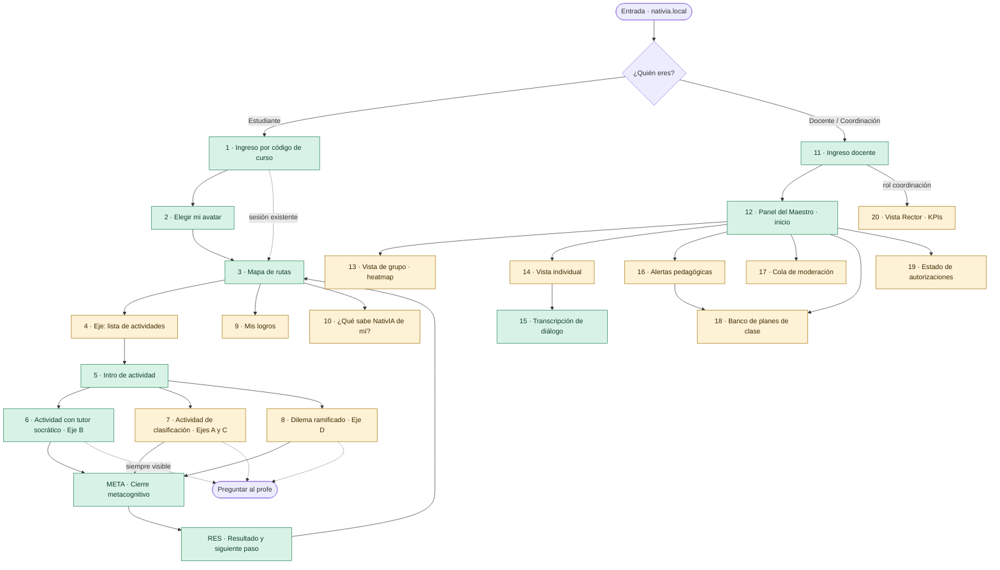
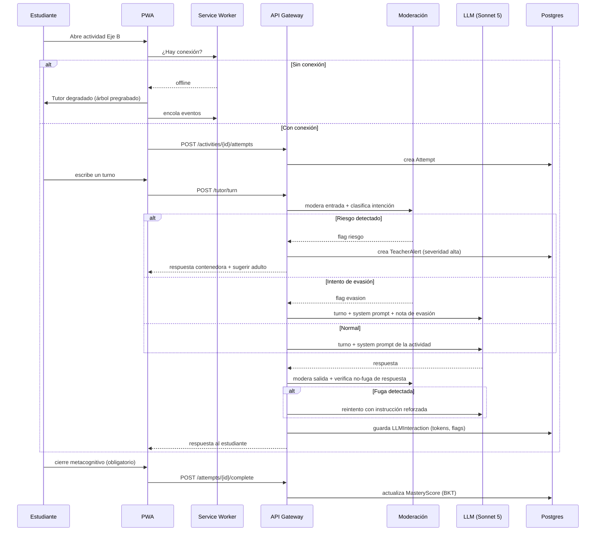

# 02 · Arquitectura de información y wireframes

**Alcance:** mapa de navegación de los tres módulos + wireframes de las 20 pantallas críticas.
Notación: ASCII para layout, Mermaid para flujos. Resolución de referencia: **1024×600**
(tableta de gama baja en horizontal, el peor caso real del aula).

---

## 1. Principios de arquitectura de información

| # | Principio | Consecuencia concreta |
|---|---|---|
| 1 | **Profundidad máxima de 3 niveles** para el estudiante | Un niño de 8 años nunca está a más de 3 toques de volver al mapa |
| 2 | **Una acción principal por pantalla** | Un solo botón grande y primario; el resto es secundario y visualmente menor |
| 3 | **Sin callejones sin salida** | Toda pantalla tiene salida visible: volver, o "Preguntar al profe" |
| 4 | **La persistencia es del sistema, no del niño** | Nunca se pide "guardar"; el progreso se guarda solo, incluso sin red |
| 5 | **Iconografía + texto, nunca icono solo** | Lectores en desarrollo y usuarios con dislexia dependen del par |
| 6 | **El docente lee de arriba a abajo, no explora** | Lo más accionable arriba; jerarquía por urgencia, no por categoría |
| 7 | **El estado del sistema siempre es visible** | Conexión, sincronización, modo tutor: indicadores persistentes y discretos |

---

## 2. Mapa de navegación global



> Verde = construido en el prototipo · Ámbar = diseñado, no construido.

---

## 3. Modelo de contenido

```
Institución
└── Sede ── Jornada
    └── Curso (Grado 3.º/4.º/5.º)
        └── Estudiante
            └── Ruta de aprendizaje  (asignada por grado)
                └── Eje  (A · B · C · D)
                    └── Actividad  ← unidad mínima navegable
                        ├── metadata: competencia PISA, DBA, nivel Bloom, minutos
                        ├── pasos (1..n)
                        ├── cierre metacognitivo (obligatorio)
                        └── intentos → eventos → mastery
```

**Regla de navegación:** el estudiante nunca ve "Ruta"; ve el **Mapa**, que es la representación
visual de la ruta. La jerarquía existe en datos, no en la interfaz.

---

## 4. Los cuatro ejes en la interfaz

| Eje | Nombre visible para el niño | Color | Metáfora visual | Requiere red |
|---|---|---|---|---|
| A | "¿Qué es la IA?" | Índigo | Brújula | No |
| B | "Piensa con la IA" | Verde | Brote (Nati) | Sí (degrada) |
| C | "Detective de IA" | Ámbar | Lupa | No |
| D | "Decide bien" | Coral | Balanza | No |

---

## 5. Wireframes — 20 pantallas críticas

### Convenciones ASCII

```
[ Botón primario ]     ( botón secundario )     « volver »
▓ elemento sólido      ░ elemento atenuado      ▲▼ scroll
● indicador activo     ○ indicador inactivo     ⚠ alerta
```

---

### Pantalla 1 · Ingreso por código de curso `[estudiante]` ✅

```
┌──────────────────────────────────────────────────────────────────────┐
│                                                        ○ sin conexión│
│                                                                      │
│                        🐦  C O L I B R Í                             │
│                    Aprende a pensar con la IA                        │
│                                                                      │
│              Escribe el código que te dio tu profe                   │
│                                                                      │
│                  ┌────┐ ┌────┐ ┌────┐ ┌────┐                        │
│                  │ 4  │ │ B  │ │ 7  │ │ K  │                        │
│                  └────┘ └────┘ └────┘ └────┘                        │
│                                                                      │
│                     [    Entrar    ]                                 │
│                                                                      │
│                   ( Soy profe → )        🔊 Escuchar                 │
└──────────────────────────────────────────────────────────────────────┘
```

**Notas de diseño**
- Sin contraseña alfanumérica: código de curso de 4 caracteres + selección visual del propio avatar
  en la pantalla siguiente. Es el compromiso realista entre seguridad y una tableta compartida por
  tres niños de 8 años.
- Caracteres del código sin ambigüedad visual: se excluyen `O/0`, `I/1/l`, `S/5`.
- El botón 🔊 lee la pantalla en voz alta. Presente en **todas** las pantallas del módulo estudiante.
- El indicador de conexión es informativo, nunca bloqueante.

---

### Pantalla 2 · Elegir mi avatar `[estudiante]` ✅

```
┌──────────────────────────────────────────────────────────────────────┐
│ « volver                    Curso 4B · Prof. Luz Mery       🔊       │
│                                                                      │
│                     ¿Cuál eres tú?                                   │
│                                                                      │
│   ┌───────┐  ┌───────┐  ┌───────┐  ┌───────┐  ┌───────┐            │
│   │  🦊   │  │  🐢   │  │  🦜   │  │  🐆   │  │  🦋   │            │
│   │ Sara  │  │Andrés │  │ Keila │  │ Juan  │  │ Luisa │            │
│   └───────┘  └───────┘  └───────┘  └───────┘  └───────┘            │
│                                                                      │
│   ┌───────┐  ┌───────┐  ┌───────┐                            ▼      │
│   │  🐝   │  │  🦥   │  │  🐸   │                                   │
│   │ Mateo │  │ Elena │  │ Diego │                                   │
│   └───────┘  └───────┘  └───────┘                                   │
│                                                                      │
│              No me encuentro → ( Avisar al profe )                   │
└──────────────────────────────────────────────────────────────────────┘
```

**Notas**
- El avatar es **fauna colombiana ilustrada**, nunca una foto ni una figura humana realista:
  minimización de datos y evitación de sesgos de representación corporal.
- Cambiar de estudiante en la tableta compartida = volver a esta pantalla. Es la operación más
  frecuente del aula, por eso está a un toque desde el mapa.
- `[SUPUESTO]` Mostrar el nombre de pila junto al avatar en una pantalla accesible con solo el código
  del curso expone la lista de nombres del salón. Se acepta para el prototipo por usabilidad; en
  producción debe evaluarse mostrar solo el avatar elegido por cada niño en su primer ingreso.

---

### Pantalla 3 · Mapa de rutas `[estudiante]` ✅ — pantalla ancla

```
┌──────────────────────────────────────────────────────────────────────┐
│ 🦊 Sara · 4.º       ▓▓▓▓▓▓▓░░░ 7 de 12       🏅 4    ⚙   🔊         │
├──────────────────────────────────────────────────────────────────────┤
│                                                                      │
│    ┌────────────────────┐        ┌────────────────────┐             │
│    │ 🧭  ¿Qué es la IA? │        │ 🐦 Piensa con la IA│             │
│    │ ●●●○  3 de 4       │        │ ●●○○  2 de 4       │             │
│    │ [ Continuar ]      │        │ [ Continuar ]      │             │
│    └────────────────────┘        └────────────────────┘             │
│                                                                      │
│    ┌────────────────────┐        ┌────────────────────┐             │
│    │ 🔍 Detective de IA │        │ ⚖  Decide bien     │             │
│    │ ●●○○  2 de 4       │        │ ○○○○  0 de 4       │             │
│    │ [ Continuar ]      │        │ [ Empezar ]        │             │
│    └────────────────────┘        └────────────────────┘             │
│                                                                      │
├──────────────────────────────────────────────────────────────────────┤
│  🏅 Mis logros    │  🔒 ¿Qué sabe de mí?   │  🙋 Preguntar al profe  │
└──────────────────────────────────────────────────────────────────────┘
```

**Notas**
- Los cuatro ejes están **siempre visibles sin scroll**: el niño ve el todo, no un camino lineal
  forzado. Elegir es parte de la experiencia.
- Progreso por puntos, no por porcentaje: los porcentajes son abstractos a los 8 años.
- **No hay ranking ni comparación con compañeros en ninguna parte de esta pantalla.** Decisión
  permanente (PRD, E-17 *Won't*).
- La barra inferior es persistente en todo el módulo estudiante.

---

### Pantalla 4 · Lista de actividades del eje `[estudiante]` 📐

```
┌──────────────────────────────────────────────────────────────────────┐
│ « Mapa            🐦 Piensa con la IA                       🔊       │
├──────────────────────────────────────────────────────────────────────┤
│  Aquí la IA no te da respuestas: te hace preguntas.                  │
│                                                                      │
│  ✔ 1. El repartidor confundido            Matemáticas   ~8 min       │
│       Lo lograste sin ayuda                                          │
│  ─────────────────────────────────────────────────────────────       │
│  ✔ 2. El texto que se repite               Lenguaje      ~10 min     │
│       Lo lograste con pistas                                         │
│  ─────────────────────────────────────────────────────────────       │
│  ▶ 3. ¿Y si mi hipótesis está mal?         Ciencias      ~12 min     │
│       [ Empezar ]                            ⚡ necesita internet     │
│  ─────────────────────────────────────────────────────────────       │
│  ░ 4. El problema de los tres buses        Matemáticas   ~10 min     │
│       Se abre cuando termines la 3                                   │
└──────────────────────────────────────────────────────────────────────┘
```

**Notas**
- «Lo lograste con pistas» en vez de un puntaje: el andamiaje se reconoce, no se penaliza.
- El indicador ⚡ aparece **antes** de entrar, para que el niño no se frustre a mitad de camino
  cuando no hay red.

---

### Pantalla 5 · Introducción de actividad `[estudiante]` ✅

```
┌──────────────────────────────────────────────────────────────────────┐
│ « volver                                                     🔊      │
│                                                                      │
│                    El repartidor confundido                          │
│                    ─────────────────────────                         │
│                                                                      │
│        📐 Matemáticas    ⏱ 8 minutos    🐦 Piensa con la IA          │
│                                                                      │
│    En esta actividad vas a revisar si una IA hizo bien una cuenta.   │
│                                                                      │
│    ┌────────────────────────────────────────────────────────────┐   │
│    │ 🤖  El tutor NO te va a dar la respuesta.                  │   │
│    │     Te va a hacer preguntas para que la encuentres tú.     │   │
│    └────────────────────────────────────────────────────────────┘   │
│                                                                      │
│                     [    Empezar    ]                                │
└──────────────────────────────────────────────────────────────────────┘
```

**Notas** — La expectativa se fija **antes** de empezar. La causa principal de frustración con un
tutor socrático es esperar una respuesta que nunca llega; esta pantalla existe para eliminarla.

---

### Pantalla 6 · Actividad con tutor socrático `[estudiante]` ✅ — pantalla más crítica

```
┌──────────────────────────────────────────────────────────────────────┐
│ « salir      El repartidor confundido      ⏱ 3:20     🔊   🙋       │
├────────────────────────────────┬─────────────────────────────────────┤
│  EL PROBLEMA                   │  TU CONVERSACIÓN                    │
│                                │                                     │
│  María tiene 24 arepas para    │  🐦 Hola Sara. Mira lo que dijo    │
│  repartir entre 6 amigos.      │     la IA. ¿Tú qué opinas?         │
│                                │                                     │
│  Le preguntó a una IA cuántas  │  🦊 creo que está mal              │
│  le tocan a cada uno.          │                                     │
│                                │  🐦 ¿Y cómo podrías comprobarlo    │
│  ┌──────────────────────────┐  │     sin usar la IA?                │
│  │ 🤖 La IA respondió:      │  │                                     │
│  │                          │  │  🦊 contando                       │
│  │ "A cada amigo le tocan   │  │                                     │
│  │  5 arepas."              │  │  🐦 ¡Buena idea! Si le das 5 a     │
│  │                          │  │     cada uno de los 6 amigos,      │
│  │ ⚠ Esto lo dijo una IA.   │  │     ¿cuántas arepas repartiste?    │
│  │   Puede equivocarse. ⓘ   │  │                                ▼    │
│  └──────────────────────────┘  ├─────────────────────────────────────┤
│                                │ ┌─────────────────────────┐ [ ▶ ]  │
│  ✏ Mi comprobación:            │ │ Escribe aquí…       🎤 │        │
│  [ Anotar cómo lo verifiqué ]  │ └─────────────────────────┘        │
└────────────────────────────────┴─────────────────────────────────────┘
```

**Notas de diseño — cada elemento tiene una justificación pedagógica**
- **El problema queda fijo a la izquierda.** El niño no debe hacer scroll hacia arriba para recordar
  el enunciado; la carga cognitiva debe ir al razonamiento, no a la navegación.
- **La respuesta de la IA está encapsulada y etiquetada** con el aviso ⚠ persistente (requisito
  E-07). El ⓘ expande: *"La IA arma frases que suenan bien, pero a veces se equivoca. Por eso tú la
  revisas."*
- **"Mi comprobación"** es el widget que produce la North Star Metric (ISVI). Está a la vista desde
  el primer segundo, no aparece al final: sugiere la conducta antes de que el tutor la pida.
- **🎤 entrada por voz** — `[C]` en el MVP, pero el espacio está reservado en el layout: para muchos
  niños de 3.º explicar hablando es más rico que escribiendo.
- **🙋 "Preguntar al profe"** en la barra superior, siempre. Escapatoria a un adulto real.
- En pantallas menores a 900 px de ancho, las dos columnas se apilan y el problema se vuelve un
  panel colapsable fijo en la parte superior.

**Estado degradado (sin conexión o presupuesto agotado):**

```
│  🐦 Ahora mismo no tengo internet, pero igual te acompaño.          │
│     Vamos paso a paso.                                              │
│     ┌──────────────────────────────────────────────────────────┐   │
│     │ ¿Qué pasaría si le das 5 arepas a cada uno de los 6?     │   │
│     │  ( Sobran )   ( Faltan )   ( Quedan justas )             │   │
│     └──────────────────────────────────────────────────────────┘   │
```

El árbol pregrabado usa **opciones cerradas** en vez de texto libre: sin LLM no se puede interpretar
lenguaje natural abierto, y ofrecer un campo de texto que no entiende nada sería peor que no
ofrecerlo.

---

### Pantalla 7 · Clasificación con pistas `[estudiante]` 📐 `Ejes A y C`

```
┌──────────────────────────────────────────────────────────────────────┐
│ « salir       🔍 ¿Real o hecho por IA?      3 de 6      🔊   🙋     │
├──────────────────────────────────────────────────────────────────────┤
│                                                                      │
│        ┌────────────────────────────────────────────────┐           │
│        │                                                │           │
│        │           [ imagen del estímulo ]              │           │
│        │                                                │           │
│        │                                    🔍 acercar  │           │
│        └────────────────────────────────────────────────┘           │
│                                                                      │
│              [ 📷 Es real ]        [ 🤖 La hizo una IA ]            │
│                                                                      │
│   ┌──────────────────────────────────────────────────────────────┐  │
│   │ 💡 Pista 1 de 3: mira con cuidado las manos de las personas. │  │
│   └──────────────────────────────────────────────────────────────┘  │
│                                                                      │
│   ●●○○○○  ← tu avance                          ( Necesito otra pista)│
└──────────────────────────────────────────────────────────────────────┘
```

Tras elegir, **se exige justificación** antes de continuar (requisito US-02):

```
   ¿Qué señal viste? Elige al menos una:
   ☐ Las manos se ven raras        ☐ La luz no coincide
   ☐ El texto del fondo no se lee  ☐ Algo se repite de forma extraña
   ☐ Otra cosa: [___________________________]
                                            [ Confirmar ]
```

---

### Pantalla 8 · Dilema ramificado `[estudiante]` 📐 `Eje D`

```
┌──────────────────────────────────────────────────────────────────────┐
│ « salir            ⚖ La tarea de mi hermanita          🔊    🙋     │
├──────────────────────────────────────────────────────────────────────┤
│                                                                      │
│   Tu hermanita de 2.º tiene que escribir un cuento para mañana.      │
│   Está llorando porque no se le ocurre nada. Tú sabes usar la IA.    │
│                                                                      │
│   ¿Qué haces?                                                        │
│                                                                      │
│   ┌────────────────────────────────────────────────────────────┐    │
│   │ A · Le pido a la IA que escriba el cuento y se lo doy.     │    │
│   ├────────────────────────────────────────────────────────────┤    │
│   │ B · Le pido a la IA ideas y ella escribe con sus palabras. │    │
│   ├────────────────────────────────────────────────────────────┤    │
│   │ C · La ayudo yo sin usar la IA.                            │    │
│   ├────────────────────────────────────────────────────────────┤    │
│   │ D · Le digo que le pregunte a la profe mañana.             │    │
│   └────────────────────────────────────────────────────────────┘    │
│                                                                      │
│   No hay una única respuesta correcta. Vas a ver qué pasa después.   │
└──────────────────────────────────────────────────────────────────────┘
```

**Notas** — El dilema **no califica**: ramifica. Cada opción despliega una consecuencia narrativa y
una pregunta de segundo orden ("¿y si la profe pregunta cómo lo hizo?"). El objetivo Bloom es
*evaluar*, no acertar. El indicador registrado es la **calidad del argumento**, no la opción elegida.

---

### Pantalla META · Cierre metacognitivo `[estudiante]` ✅ — obligatoria

```
┌──────────────────────────────────────────────────────────────────────┐
│                                                              🔊      │
│                    Antes de terminar…                                │
│                                                                      │
│              ¿Qué aprendiste sobre cómo TÚ piensas?                  │
│                                                                      │
│   ┌────────────────────────────────────────────────────────────┐    │
│   │ Escribe o graba tu respuesta…                        🎤    │    │
│   └────────────────────────────────────────────────────────────┘    │
│                                                                      │
│   ¿Te ayuda alguna de estas?                                         │
│   ( Me di cuenta solo )   ( Necesité comprobar )                     │
│   ( Al principio le creí ) ( Cambié de idea )                        │
│                                                                      │
│                     [    Listo    ]                                  │
│                                                                      │
│   Esto no se califica. Es para que TÚ te des cuenta.                 │
└──────────────────────────────────────────────────────────────────────┘
```

**Notas** — Bloqueante por diseño (US-03). Las opciones sugeridas son **andamiaje de vocabulario
metacognitivo**: a los 8 años no se tiene el lenguaje para describir el propio pensamiento, y darle
palabras es parte de la enseñanza. La frase final ("esto no se califica") es indispensable: sin ella
los niños responden lo que creen que el adulto quiere oír.

---

### Pantalla RES · Resultado y siguiente paso `[estudiante]` ✅

```
┌──────────────────────────────────────────────────────────────────────┐
│                        ¡Lo lograste!                          🔊     │
│                                                                      │
│                            🏅                                        │
│                    Nuevo logro: Verificador                          │
│              "Comprobaste una respuesta por tu cuenta"               │
│                                                                      │
│   Lo que hiciste bien:                                               │
│   ✔ No aceptaste la respuesta de la IA sin revisarla                 │
│   ✔ Encontraste una forma de comprobarlo tú mismo                    │
│                                                                      │
│   Para la próxima:                                                   │
│   → Intenta explicar con tus palabras POR QUÉ estaba mal             │
│                                                                      │
│        ( Volver al mapa )        [ Siguiente actividad ]             │
└──────────────────────────────────────────────────────────────────────┘
```

**Notas** — La retroalimentación describe **procesos, no resultados** ("no aceptaste sin revisar", no
"acertaste"). Es la diferencia entre reforzar mentalidad de crecimiento y reforzar la búsqueda de la
respuesta correcta — que es exactamente el hábito que el producto combate.

---

### Pantalla 9 · Mis logros `[estudiante]` 📐

```
┌──────────────────────────────────────────────────────────────────────┐
│ « Mapa                    🏅 Mis logros                    🔊        │
├──────────────────────────────────────────────────────────────────────┤
│  🦊 Sara · 4.º B                                                     │
│                                                                      │
│   Conseguidos (4)                                                    │
│   ┌────────┐ ┌────────┐ ┌────────┐ ┌────────┐                      │
│   │  🔍    │ │  ✅    │ │  🤔    │ │  ⚖    │                      │
│   │Detective│ │Verifi- │ │Pregun- │ │ Justa  │                      │
│   │ novato │ │ cadora │ │ tona   │ │        │                      │
│   └────────┘ └────────┘ └────────┘ └────────┘                      │
│                                                                      │
│   Por conseguir (8)                                                  │
│   ┌────────┐ ┌────────┐ ┌────────┐                                 │
│   │  ░🔒   │ │  ░🔒   │ │  ░🔒   │                                 │
│   │Detecta │ │Explica │ │ Duda   │                                 │
│   │ 5 fotos│ │ tu idea│ │ bien   │                                 │
│   └────────┘ └────────┘ └────────┘                                 │
│                                                                      │
│   Tu equipo 4B lleva 87 comprobaciones esta semana 🎉                │
└──────────────────────────────────────────────────────────────────────┘
```

**Notas** — Los logros premian **conductas epistémicas** ("Preguntona", "Duda bien"), no volumen de
ejercicios. El único elemento social es **agregado del curso**, nunca individual comparativo.

---

### Pantalla 10 · ¿Qué sabe NativIA de mí? `[estudiante]` 📐 — transparencia infantil

```
┌──────────────────────────────────────────────────────────────────────┐
│ « Mapa              🔒 ¿Qué sabe NativIA de mí?             🔊       │
├──────────────────────────────────────────────────────────────────────┤
│                                                                      │
│   ✅ Lo que NativIA guarda                                           │
│   ┌────────────────────────────────────────────────────────────┐    │
│   │ 📛 Tu nombre y tu curso  → para saber que eres tú          │    │
│   │ 🎯 Las actividades que haces → para mostrarte tu avance    │    │
│   │ 💬 Lo que hablas con el tutor → tu profe puede leerlo      │    │
│   │ ✍ Lo que escribes al final → para que tu profe te ayude    │    │
│   └────────────────────────────────────────────────────────────┘    │
│                                                                      │
│   🚫 Lo que NativIA NUNCA guarda                                     │
│   ┌────────────────────────────────────────────────────────────┐    │
│   │ 📷 Tu foto      🏠 Tu dirección      📱 Tu teléfono        │    │
│   └────────────────────────────────────────────────────────────┘    │
│                                                                      │
│   👀 Tu profe Luz Mery puede ver lo que hablas con el tutor.         │
│      No es un secreto: es para poder ayudarte mejor.                 │
│                                                                      │
│   ¿Tienes dudas?  ( Preguntar al profe )                             │
└──────────────────────────────────────────────────────────────────────┘
```

**Notas** — Esta pantalla es un requisito ético, no una función. Decirle al niño que el docente lee
sus conversaciones **antes** de que lo descubra es la diferencia entre transparencia y vigilancia.
Nivel de lectura objetivo: 3.º de primaria; validado con lectura en voz alta ante niños reales.

---

### Pantalla 11 · Ingreso docente `[docente]` ✅

```
┌──────────────────────────────────────────────────────────────────────┐
│                        🐦  C O L I B R Í                             │
│                        Panel del Maestro                             │
│                                                                      │
│      Correo institucional                                            │
│      ┌────────────────────────────────────────────────┐             │
│      │                                                │             │
│      └────────────────────────────────────────────────┘             │
│      Contraseña                                                      │
│      ┌────────────────────────────────────────────────┐             │
│      │                                                │             │
│      └────────────────────────────────────────────────┘             │
│                                                                      │
│                     [    Entrar    ]                                 │
│                                                                      │
│      ( Olvidé mi contraseña )         ( ← Soy estudiante )           │
└──────────────────────────────────────────────────────────────────────┘
```

---

### Pantalla 12 · Panel del Maestro · inicio `[docente]` ✅ — la prueba de los 60 segundos

```
┌──────────────────────────────────────────────────────────────────────┐
│ 🐦 NativIA   Curso 4.º B · 32 estudiantes ▾      Prof. Luz Mery ▾   │
├──────────────────────────────────────────────────────────────────────┤
│                                                                      │
│  ⚠ NECESITAN TU AYUDA HOY                                           │
│  ┌────────────────────────────────────────────────────────────────┐ │
│  │ 🐆 Juan P.   Lleva 3 actividades aceptando lo que dice la IA   │ │
│  │              sin comprobarlo.              [ Ver conversación ]│ │
│  ├────────────────────────────────────────────────────────────────┤ │
│  │ 🦥 Elena M.  No ha entrado en 8 días.        [ Ver detalle ]   │ │
│  ├────────────────────────────────────────────────────────────────┤ │
│  │ 🐝 Mateo R.  Se atasca siempre en el mismo paso de división.   │ │
│  │                                              [ Ver detalle ]   │ │
│  └────────────────────────────────────────────────────────────────┘ │
│                                                                      │
│  📊 TU GRUPO ESTA SEMANA                                             │
│  ┌────────────────────────────────────────────────────────────────┐ │
│  │ Lo que mejor va:   Detectar imágenes hechas por IA    ▓▓▓▓▓▓░ │ │
│  │ Lo que peor va:    Explicar por qué una cuenta está mal ▓▓░░░░ │ │
│  │                                                                │ │
│  │ 💡 14 estudiantes tienen dificultad para justificar sus        │ │
│  │    respuestas.  → [ Plan de clase: "Explícalo sin números" ]   │ │
│  └────────────────────────────────────────────────────────────────┘ │
│                                                                      │
│  🛡 2 conversaciones esperan tu revisión        [ Revisar ahora ]    │
│                                                                      │
├──────────────────────────────────────────────────────────────────────┤
│ Inicio │ Mi grupo │ Estudiantes │ Alertas │ Planes de clase │ Permisos│
└──────────────────────────────────────────────────────────────────────┘
```

**Notas — esta pantalla decide la adopción del producto**
- **Nombres antes que números.** El docente piensa en Juan y Elena, no en percentiles.
- **Cada bloque termina en una acción**, nunca en un dato. Un panel que informa sin proponer qué
  hacer genera trabajo en lugar de ahorrarlo.
- **Cero jerga.** No aparece "mastery", "PISA 2.3", "BKT" ni "engagement" en toda la pantalla. La
  trazabilidad a competencias PISA existe en la vista de grupo, con su glosario.
- **Máximo 3 alertas.** Diez alertas equivalen a ninguna.

---

### Pantalla 13 · Vista de grupo · heatmap `[docente]` 📐

```
┌──────────────────────────────────────────────────────────────────────┐
│ « Inicio        Mi grupo · 4.º B          Ver por: [ Competencia ▾ ] │
├──────────────────────────────────────────────────────────────────────┤
│                  ¿Qué   Piensa  Detec-  Decide                       │
│                  es IA? con IA  tive    bien                         │
│                  ─────  ─────   ─────   ─────                        │
│  🦊 Sara G.       ███    ███     ██▒     ▒▒▒                         │
│  🐆 Juan P.       ██▒    ▒▒▒     ██▒     ▒▒▒     ⚠                   │
│  🦜 Keila M.      ███    ███     ███     ██▒                         │
│  🐢 Andrés L.     ███    ██▒     ███     ███                         │
│  🐝 Mateo R.      ██▒    ▒▒▒     ██▒     ▒▒▒     ⚠                   │
│  🦥 Elena M.      ▒▒▒    ▒▒▒     ▒▒▒     ▒▒▒     ⚠ sin actividad     │
│  …                                                            ▼      │
├──────────────────────────────────────────────────────────────────────┤
│  ███ Lo maneja bien   ██▒ Va en camino   ▒▒▒ Necesita apoyo          │
│                                                                      │
│  ℹ Cada eje se relaciona con competencias de las pruebas             │
│    internacionales PISA.  ( Ver equivalencias )                      │
└──────────────────────────────────────────────────────────────────────┘
```

**Notas** — Tres niveles, no una escala continua ni un número: el docente necesita **decidir a quién
atender**, no medir con precisión. El selector permite conmutar entre vista por eje (lenguaje del
producto) y vista por competencia PISA/DBA (lenguaje del reporte institucional).

---

### Pantalla 14 · Vista individual `[docente]` 📐

```
┌──────────────────────────────────────────────────────────────────────┐
│ « Mi grupo               🐆 Juan Pablo R. · 4.º B                    │
├──────────────────────────────────────────────────────────────────────┤
│  Últimos 30 días:  12 actividades · 2 h 40 min · 8 días activos      │
│                                                                      │
│  ⚠ LO QUE MÁS PREOCUPA                                              │
│  ┌────────────────────────────────────────────────────────────────┐ │
│  │ En 3 de sus últimas 4 conversaciones aceptó lo que dijo la IA  │ │
│  │ sin comprobarlo. Es el patrón que este programa busca cambiar. │ │
│  │                                                                │ │
│  │ Sugerencia: pídele que te explique en voz alta cómo comprobó   │ │
│  │ una respuesta. Actividad recomendada: "El repartidor           │ │
│  │ confundido" (repetir).             [ Asignar actividad ]       │ │
│  └────────────────────────────────────────────────────────────────┘ │
│                                                                      │
│  CÓMO VA POR EJE      ¿Qué es IA? ██▒ │ Piensa ▒▒▒ │ Detective ██▒  │
│                       Decide bien ▒▒▒                                │
│                                                                      │
│  SUS ÚLTIMAS CONVERSACIONES                                          │
│  ┌────────────────────────────────────────────────────────────────┐ │
│  │ 06 sep · El repartidor confundido      🔴 aceptó sin comprobar │ │
│  │ 04 sep · El texto que se repite        🟢 comprobó solo        │ │
│  │ 02 sep · ¿Real o hecho por IA?         🟡 acertó con pistas    │ │
│  └────────────────────────────────────────────────────────────────┘ │
│                                                                      │
│  LO QUE ÉL DICE DE SÍ MISMO (respuestas finales)                     │
│  "aprendí que a veces la ia se equivoca pero yo igual le creo"       │
│                                                        06 sep        │
└──────────────────────────────────────────────────────────────────────┘
```

**Notas** — Las respuestas metacognitivas literales del estudiante son el dato más valioso del panel
y por eso están en la vista individual, sin resumir. La cita de ejemplo muestra por qué: revela en
una frase algo que ningún indicador numérico captura.

---

### Pantalla 15 · Transcripción de diálogo `[docente]` ✅

```
┌──────────────────────────────────────────────────────────────────────┐
│ « Juan Pablo     El repartidor confundido · 06 sep · 6 min           │
├──────────────────────────────────────────────────────────────────────┤
│  🐦 Tutor 14:02                                                      │
│     Mira lo que dijo la IA. ¿Tú qué opinas?                          │
│                                                                      │
│  🐆 Juan 14:02                                                       │
│     está bien                                                        │
│                                                                      │
│  🐦 Tutor 14:03                                                      │
│     ¿Cómo podrías comprobarlo sin usar la IA?                        │
│                                                                      │
│  🐆 Juan 14:03                                                       │
│     no se dime tu la respuesta                          ⚑ pidió      │
│                                                            respuesta │
│  🐦 Tutor 14:03                                                      │
│     Te acompaño a encontrarla. Si le das 5 arepas a cada uno de      │
│     los 6 amigos, ¿cuántas repartes en total?                        │
│                                                                      │
│  🐆 Juan 14:05                                                       │
│     30                                                               │
│                                                                      │
│  🐦 Tutor 14:05                                                      │
│     ¿Y cuántas arepas tenía María?                                   │
│                                                                ▼     │
├──────────────────────────────────────────────────────────────────────┤
│  Al final escribió: "aprendí que a veces la ia se equivoca pero yo   │
│  igual le creo"                                                      │
│                                                                      │
│  ( Marcar para seguimiento )    ( Reportar un problema )             │
│                                                                      │
│  🔒 Tu consulta de esta conversación queda registrada.               │
└──────────────────────────────────────────────────────────────────────┘
```

**Notas** — El aviso final no es un detalle legal: es la contraparte de haberle dicho al niño que su
docente puede leer. La auditoría del acceso docente protege al menor y también al docente.

---

### Pantalla 16 · Alertas pedagógicas `[docente]` 📐

```
┌──────────────────────────────────────────────────────────────────────┐
│ « Inicio                  Alertas · 4.º B              [ Todas ▾ ]   │
├──────────────────────────────────────────────────────────────────────┤
│  🔴 ALTA · hace 2 horas                                              │
│  ┌────────────────────────────────────────────────────────────────┐ │
│  │ Una conversación necesita tu revisión.                         │ │
│  │ Un estudiante escribió algo que puede indicar malestar.        │ │
│  │                          [ Revisar ahora ]  ( Ver protocolo )  │ │
│  └────────────────────────────────────────────────────────────────┘ │
│                                                                      │
│  🟡 GRUPAL · hace 1 día                                              │
│  ┌────────────────────────────────────────────────────────────────┐ │
│  │ 14 de 32 estudiantes no logran explicar por qué una respuesta  │ │
│  │ está mal, aunque detectan que lo está.                         │ │
│  │ → Plan sugerido: "Explícalo sin números" (25 min, presencial)  │ │
│  │        [ Ver plan de clase ]   ( Atendida )   ( No aplica )    │ │
│  └────────────────────────────────────────────────────────────────┘ │
│                                                                      │
│  🟡 INDIVIDUAL · hace 2 días                                         │
│  ┌────────────────────────────────────────────────────────────────┐ │
│  │ Elena M. no ha entrado en 8 días.                              │ │
│  │        [ Ver detalle ]        ( Atendida )   ( No aplica )     │ │
│  └────────────────────────────────────────────────────────────────┘ │
└──────────────────────────────────────────────────────────────────────┘
```

**Notas** — El botón *( No aplica )* es tan importante como *( Atendida )*: alimenta el ajuste de las
reglas del motor de alertas. Un sistema de alertas que no aprende del descarte termina ignorado.
Las alertas de riesgo (🔴) **no muestran el contenido sensible en el listado**; requieren un clic
deliberado, para evitar exposición accidental en un salón con la pantalla proyectada.

---

### Pantalla 17 · Cola de moderación `[docente]` 📐

```
┌──────────────────────────────────────────────────────────────────────┐
│ « Inicio        🛡 Revisión de conversaciones · 2 pendientes         │
├──────────────────────────────────────────────────────────────────────┤
│  Estas conversaciones fueron marcadas por el sistema. Tú decides.    │
│                                                                      │
│  ┌────────────────────────────────────────────────────────────────┐ │
│  │ 🐆 Juan P. · hoy 14:03                                         │ │
│  │ Motivo: pidió la respuesta directa 3 veces seguidas            │ │
│  │                                                                │ │
│  │ "no se dime tu la respuesta"                                   │ │
│  │                                                                │ │
│  │ ( Está bien, es normal )  ( Hablar con él )  [ Ver completa ]  │ │
│  ├────────────────────────────────────────────────────────────────┤ │
│  │ 🦜 Keila M. · ayer 10:22                                       │ │
│  │ Motivo: mencionó información personal                          │ │
│  │                                                                │ │
│  │ [ contenido oculto — clic para ver ]                           │ │
│  │                                                                │ │
│  │ ( Ya lo hablé )  ( Escalar a orientación )  [ Ver completa ]   │ │
│  └────────────────────────────────────────────────────────────────┘ │
└──────────────────────────────────────────────────────────────────────┘
```

---

### Pantalla 18 · Banco de planes de clase `[docente]` 📐

```
┌──────────────────────────────────────────────────────────────────────┐
│ « Inicio     Planes de clase      [ 4.º ▾ ] [ Todos los ejes ▾ ]    │
├──────────────────────────────────────────────────────────────────────┤
│  ⭐ RECOMENDADO PARA TU GRUPO AHORA                                  │
│  ┌────────────────────────────────────────────────────────────────┐ │
│  │ Explícalo sin números                          25 min · 4.º    │ │
│  │ Los estudiantes explican en parejas por qué una respuesta      │ │
│  │ está mal, sin escribir ninguna operación.                      │ │
│  │ Materiales: ninguno.  PISA: interpretar y evaluar resultados.  │ │
│  │                       [ Ver plan ]   ( Descargar PDF )         │ │
│  └────────────────────────────────────────────────────────────────┘ │
│                                                                      │
│  TODOS LOS PLANES                                                    │
│  · El museo de errores de la IA          30 min · 3.º–5.º · Eje A   │
│  · Reportero verificador                 40 min · 5.º   · Eje C     │
│  · El juicio a la IA (debate)            45 min · 4.º–5.º · Eje D   │
│  · ¿La IA conoce mi barrio?              35 min · 3.º   · Eje D     │
└──────────────────────────────────────────────────────────────────────┘
```

**Notas** — «Materiales: ninguno» es un campo obligatorio y prioritario. Un plan que exige recursos
que la escuela no tiene no se ejecuta.

---

### Pantalla 19 · Estado de autorizaciones `[docente]` 📐

```
┌──────────────────────────────────────────────────────────────────────┐
│ « Inicio          Permisos de las familias · 4.º B                   │
├──────────────────────────────────────────────────────────────────────┤
│  Un estudiante no puede usar NativIA sin la autorización de su       │
│  acudiente. Aquí ves quién falta.                                    │
│                                                                      │
│  ✅ Autorizados         28 de 32                                     │
│  ⏳ Pendientes           3    [ Reenviar comunicación ]              │
│  🚫 No autorizados       1    (no aparece en la app)                 │
│                                                                      │
│  PENDIENTES                                                          │
│  · Diego S.    enviado 01 sep · sin respuesta   [ Recordar ]         │
│  · Luisa F.    enviado 01 sep · sin respuesta   [ Recordar ]         │
│  · Camilo T.   no enviado                       [ Enviar ]           │
│                                                                      │
│  ℹ Un acudiente puede retirar su autorización cuando quiera.         │
│    Si lo hace, la cuenta se desactiva en menos de 24 horas.          │
└──────────────────────────────────────────────────────────────────────┘
```

> `[SUPUESTO — VALIDACIÓN JURÍDICA PENDIENTE]` El mecanismo concreto de autorización (institucional,
> digital del acudiente, o híbrido) está sin definir. La pantalla asume el flujo híbrido y es
> parametrizable.

---

### Pantalla 20 · Vista Rector · KPIs `[coordinación]` 📐 `[DIFERIDO post-MVP]`

```
┌──────────────────────────────────────────────────────────────────────┐
│ 🐦 NativIA · IED Ejemplo        Sede A ▾  Jornada Mañana ▾  Sep 2026 │
├──────────────────────────────────────────────────────────────────────┤
│  ┌──────────────┬──────────────┬──────────────┬──────────────┐      │
│  │ Estudiantes  │ Actividades  │ Docentes     │ Autorizacio- │      │
│  │ activos      │ completadas  │ activos      │ nes vigentes │      │
│  │   412 / 480  │    3.847     │   14 / 16    │    94 %      │      │
│  │   ▲ 6 %      │    ▲ 12 %    │              │              │      │
│  └──────────────┴──────────────┴──────────────┴──────────────┘      │
│                                                                      │
│  DESEMPEÑO POR GRADO Y EJE                                           │
│         ¿Qué es IA?  Piensa   Detective  Decide bien                 │
│   3.º      ▓▓▓▓░      ▓▓░░░     ▓▓▓░░      ▓▓░░░                    │
│   4.º      ▓▓▓▓▓      ▓▓▓░░     ▓▓▓▓░      ▓▓▓░░                    │
│   5.º      ▓▓▓▓▓      ▓▓▓▓░     ▓▓▓▓▓      ▓▓▓▓░                    │
│                                                                      │
│  Comparativo anónimo con el promedio del piloto:  ▲ +4 puntos        │
│                                                                      │
│  🔒 Esta vista no muestra información individual de estudiantes.     │
│                              ( Exportar informe PDF )                │
└──────────────────────────────────────────────────────────────────────┘
```

**Notas** — El aviso 🔒 es una decisión de producto permanente (PRD, R-04 *Won't*), enunciada en la
propia interfaz para que quede claro ante rectoría que la limitación es deliberada.

---

## 6. Flujo crítico: actividad con tutor socrático



---

## 7. Estados vacíos, de error y de carga

| Situación | Módulo estudiante | Módulo docente |
|---|---|---|
| Sin actividades asignadas | «Todavía no hay nada nuevo. Tu profe va a abrir más pronto.» + ilustración | «Este curso aún no tiene actividades asignadas. [Asignar]» |
| Sin conexión | Indicador ○ discreto; ejes A/C/D siguen; eje B degrada | Banner: «Estás viendo datos de hace 12 minutos» |
| Error del servidor | «Algo falló, pero tu avance está guardado. Intenta de nuevo.» + botón | Mensaje técnico + id de incidente |
| Cargando | Esqueleto del layout, nunca *spinner* solo | Esqueleto de tabla |
| Tutor pensando | «🐦 está pensando…» con animación suave, máx. 6 s antes de aviso | — |
| Sin datos aún (curso nuevo) | — | «Cuando tus estudiantes empiecen, aquí verás su avance.» |

**Regla:** ningún mensaje de error para el estudiante culpa al niño ni usa vocabulario técnico. Todo
error del estudiante afirma explícitamente que **su progreso está a salvo** — es el temor real a esa
edad.

---

<self_critique>

**Debilidad 1 — Los wireframes están dibujados a 1024×600 y la realidad del aula es peor.**
Muchas tabletas escolares son de 7–8 pulgadas y con frecuencia se usan en vertical. La pantalla 6, la
más importante del producto, depende de dos columnas simultáneas; su versión apilada está mencionada
en una línea pero no diseñada, y es probable que sea la vista que más niños usen realmente. Diseñar
el caso cómodo y dejar el caso real como nota al pie es un error clásico.
*Mitigación:* rediseñar la pantalla 6 **primero en vertical de 360 px** y derivar la versión de dos
columnas como mejora progresiva, no al revés. Levantar el inventario real de dispositivos en las
instituciones candidatas antes de cerrar el design system.

**Debilidad 2 — El ingreso con código de curso + selección de avatar es débil como autenticación.**
Cualquier niño puede entrar como cualquier compañero de su salón, y la pantalla 2 expone la lista de
nombres del curso a quien tenga el código de 4 caracteres. Dado que el sistema almacena
conversaciones de menores y respuestas metacognitivas personales, la suplantación entre compañeros no
es un riesgo trivial: habilita burla, y contamina los datos de la evaluación de impacto.
*Mitigación:* añadir un segundo factor apropiado para la edad —un PIN gráfico de 3 imágenes en
secuencia elegido por el niño, memorizable y no transcribible—, restringir la validez del código de
curso a la ventana de clase, y registrar en el audit log los ingresos con avatar distinto al del
dispositivo previo. Someter la decisión al DPIA antes del piloto.

**Debilidad 3 — Falta por completo la arquitectura de información de la gestión de aula.**
Las 20 pantallas cubren el uso individual, pero no la operación real: cambiar de estudiante en una
tableta compartida sin cerrar sesión de forma completa, el docente proyectando una actividad para
todo el curso, iniciar una sesión sincronizada, o el niño que llega tarde. Sin esas pantallas, la
herramienta funciona en la demo y falla en el salón.
*Mitigación:* añadir tres pantallas al conjunto crítico —«Cambio rápido de estudiante» (accesible en
un toque desde el mapa), «Modo proyección» para el docente y «Sesión de curso» con estado
compartido— tras una observación de campo de al menos 3 clases reales, e incorporarlas al alcance
del MVP desplazando la Vista Rector, que ya está diferida.

</self_critique>
