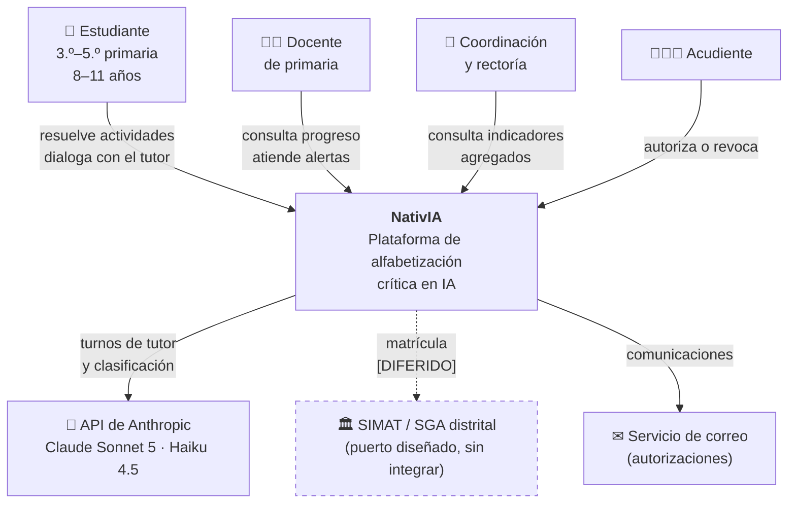
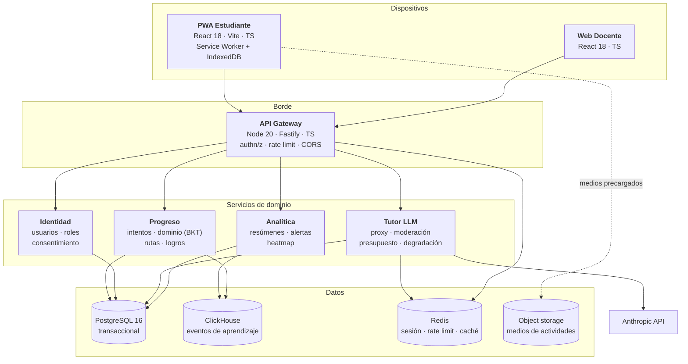
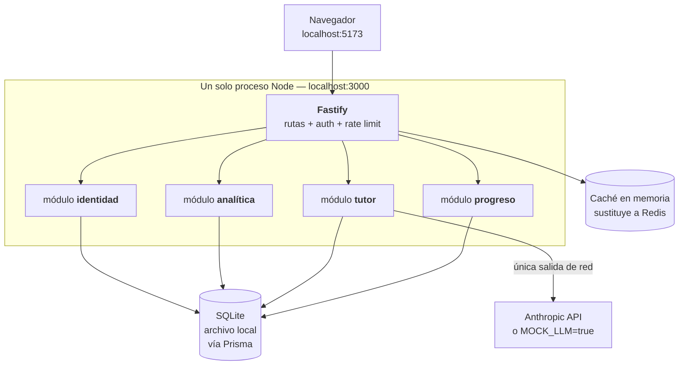
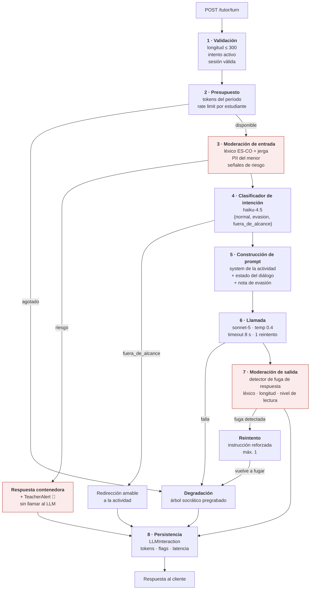

# 04 · Arquitectura técnica

**Dos arquitecturas en un documento.** La **objetivo** sustenta la viabilidad ante el Distrito; la
**del prototipo** es lo que realmente corre hoy en un computador sin presupuesto. Mezclarlas sería
deshonesto, así que se presentan separadas y con un camino explícito de una a la otra.

---

## 1. Contexto (C4 nivel 1)



**Frontera del sistema:** ningún dato personal de un menor cruza hacia SIMAT ni hacia el correo. Al
proveedor de LLM solo viaja el **contenido del turno de diálogo**, seudonimizado, bajo acuerdo de
no-entrenamiento y sin retención (ver `09-security-privacy-plan.md` §5).

---

## 2. Contenedores — arquitectura objetivo (C4 nivel 2)



## 3. Contenedores — prototipo local (lo que corre hoy)



**Las diferencias son deliberadas y todas reversibles:**

| Objetivo | Prototipo | Por qué es reversible |
|---|---|---|
| 4 servicios | 1 proceso, 4 módulos con fronteras explícitas | Los módulos ya no se llaman entre sí directamente: se comunican por interfaces de puerto |
| PostgreSQL | SQLite | Prisma abstrae el motor; el esquema es el mismo salvo tipos de fecha |
| ClickHouse | Tabla `attempt_events` en SQLite | La analítica lee de una interfaz `EventStore`, no de SQL directo |
| Redis | Caché en memoria | Detrás de una interfaz `CacheStore` |
| Object storage | Carpeta `public/media` | Rutas relativas, resueltas por configuración |
| Auth0/Clerk | JWT propio con `argon2id` | Detrás de `AuthProvider` |

---

## 4. Componentes del servicio Tutor (C4 nivel 3)

Es el componente crítico del sistema: el único con acceso al LLM y el único que toca contenido
producido por menores.



### El detector de fuga de respuesta (paso 7)

Es la garantía técnica de la propuesta de valor. Tres capas:

1. **Regla determinística.** Cada actividad declara su `forbidden_answer` (p. ej. `4`, o
   `["cuatro","4"]`). Si la salida contiene el valor como resultado afirmado —no como parte de una
   pregunta— se rechaza.
2. **Regla estructural.** La respuesta del tutor **debe contener al menos un signo de interrogación**
   salvo en el turno de cierre. Un tutor que afirma sin preguntar ya se desvió.
3. **Clasificador.** `haiku-4.5` con la pregunta binaria: *«¿esta respuesta revela el resultado que el
   estudiante debía encontrar?»*.

Las tres corren siempre. Cualquiera positiva ⇒ reintento; segunda fuga ⇒ degradación al árbol
pregrabado y `TeacherAlert`. **Nunca se muestra al niño una respuesta con fuga.**

---

## 5. Registro de decisiones de arquitectura (ADR)

---

### ADR-001 · Monolito modular en vez de microservicios

**Estado:** aceptado · **Fecha:** 2026-09-08

**Contexto.** El brief propone cuatro servicios independientes. El proyecto es un prototipo sin
presupuesto de despliegue, con un equipo pequeño, y su cuello de botella real es la producción de
contenido pedagógico, no el rendimiento.

**Decisión.** Un solo proceso Fastify con cuatro módulos de fronteras explícitas. Cada módulo expone
un puerto (interfaz TypeScript) y no importa código interno de otro. La comunicación entre módulos
pasa por esos puertos.

**Consecuencias.**
- ✅ Un comando arranca todo; un desarrollador nuevo es productivo el primer día.
- ✅ Sin latencia de red interna, sin consistencia distribuida, sin trazado distribuido.
- ✅ Extraer un módulo a servicio propio es mecánico: se reemplaza la implementación del puerto por un
  cliente HTTP.
- ❌ No escala horizontalmente por componente. Aceptable: el prototipo atiende un salón.
- ❌ Requiere disciplina para no cruzar fronteras. Mitigado con `dependency-cruiser` en CI.

**Alternativas descartadas.** Microservicios desde el inicio (complejidad operativa injustificada);
funciones serverless (arranque en frío incompatible con el objetivo de p95 < 2,5 s del primer token,
y el modo local se complica).

---

### ADR-002 · SQLite en el prototipo, PostgreSQL como objetivo

**Estado:** aceptado · **Fecha:** 2026-09-08

**Contexto.** El brief especifica PostgreSQL 16. **Docker no está instalado en la máquina de
desarrollo**, y exigir Docker + Postgres para ver el prototipo funcionando añade una barrera
desproporcionada.

**Decisión.** Prisma con SQLite en el prototipo (`file:./nativia.db`), PostgreSQL 16 como objetivo.
El esquema es único, con las diferencias de motor aisladas.

**Consecuencias.**
- ✅ `pnpm dev` y funciona. Cero infraestructura.
- ✅ La base es un archivo: se comparte, se respalda y se resetea trivialmente en una demo.
- ❌ Sin tipos `Json` nativos, sin arreglos, sin búsqueda de texto completo. **Restricción de diseño:**
  el esquema usa solo tipos portables; los campos estructurados se guardan como `String` con JSON
  serializado y un comentario que declara su forma.
- ❌ Sin concurrencia de escritura real. Irrelevante en un salón, inaceptable en producción.
- 🔁 **Migración:** cambiar `provider`, regenerar migraciones, migrar datos con un script. Estimado en
  1–2 días si la restricción de tipos portables se respetó.

---

### ADR-003 · PWA en vez de aplicación nativa

**Estado:** aceptado

**Contexto.** Tabletas compartidas, Android antiguo, iPadOS, computadores de sala de cómputo, sin
presupuesto de tiendas de aplicaciones ni de mantenimiento multiplataforma.

**Decisión.** PWA instalable con Service Worker, precarga de lecciones e IndexedDB para la cola.

**Consecuencias.**
- ✅ Un solo código base; actualizaciones instantáneas sin pasar por una tienda.
- ✅ Instalable en pantalla de inicio; funciona offline dentro de lo precargado.
- ❌ Sin acceso pleno a APIs nativas (TTS limitado por dispositivo, sin notificaciones fiables en iOS).
- ❌ La calidad del almacenamiento offline varía; iOS puede purgar datos de sitios poco usados.
- 🛡 **Mitigación:** la cola se sincroniza de forma agresiva al recuperar red; ningún dato crítico vive
  solo en el cliente más allá de una sesión.

---

### ADR-004 · Todo pasa por el proxy; el cliente jamás habla con el LLM

**Estado:** aceptado · **No negociable**

**Contexto.** Los usuarios son menores de edad. Cualquier llamada directa desde el cliente expondría
la credencial, permitiría eludir la moderación y rompería la trazabilidad.

**Decisión.** El cliente solo conoce `POST /tutor/turn`. La credencial, el system prompt, la
moderación, el presupuesto y el registro viven en el servidor. Ningún campo del cliente influye en el
system prompt.

**Consecuencias.**
- ✅ Moderación de entrada y salida garantizada; registro completo; presupuesto controlado.
- ✅ Cambiar de proveedor de LLM no toca el cliente.
- ❌ Toda interacción con el tutor requiere red. Asumido; mitigado con la degradación (ADR-005).
- ❌ El servidor es un punto único de falla para el eje B. Aceptable.

---

### ADR-005 · Degradación a árboles socráticos pregrabados

**Estado:** aceptado

**Contexto.** Conectividad intermitente (respuesta del cliente: offline para ejes A/C/D, LLM solo
online), presupuesto de tokens acotado, y fallos del proveedor.

**Decisión.** Cada actividad del eje B incluye un **árbol de diálogo socrático autorizado**,
producido por el equipo pedagógico. Se activa ante: sin red, presupuesto agotado, fallo del
proveedor, o dos fugas de respuesta consecutivas.

**Consecuencias.**
- ✅ La actividad **siempre** se puede completar. Ningún niño queda bloqueado.
- ✅ El mismo árbol alimenta `MOCK_LLM=true`: se demuestra el producto sin API key ni costo.
- ✅ Es también el guardarraíl pedagógico: el árbol es contenido revisado por humanos.
- ❌ Menos adaptativo; usa opciones cerradas en vez de texto libre.
- ❌ Duplica el trabajo de autoría: cada actividad del eje B necesita prompt **y** árbol.
- 📊 El modo queda marcado en el intento, de modo que la evaluación de impacto pueda separar los dos
  tratamientos — que en rigor son intervenciones distintas.

---

### ADR-006 · Enrutamiento por modelo

**Estado:** aceptado · **Corrige el brief**

**Contexto.** El brief especifica «Claude Sonnet 4.6», que no existe. Además, usar el modelo más
capaz para todas las tareas hace inviable el techo de USD $2/estudiante-mes.

**Decisión.**

| Tarea | Modelo | Justificación |
|---|---|---|
| Tutor socrático (eje B) | `claude-sonnet-5` | Adherencia a system prompts largos y restrictivos; calidad del diálogo |
| Clasificador de intención | `claude-haiku-4-5-20251001` | Etiqueta única, latencia baja, ~10× más barato |
| Detector de fuga (capa 3) | `claude-haiku-4-5-20251001` | Pregunta binaria |
| Clasificación de aceptación acrítica | `claude-haiku-4-5-20251001` | Trabajo por lotes, fuera de la ruta crítica |
| Redacción de alertas docentes | `claude-haiku-4-5-20251001` | Plantilla + relleno |
| Autoría de contenido curricular | `claude-opus-5` | **Fuera de producción**, herramienta del equipo pedagógico |

**Consecuencias.**
- ✅ El costo se concentra donde aporta valor pedagógico.
- ✅ Fallback documentado: si Sonnet 5 no responde, degradar al árbol —**nunca** a un modelo menos
  restringible, que aumentaría el riesgo de fuga.
- ❌ Dos modelos que evaluar y versionar. Mitigado con la suite de evals en CI.
- 📌 El id del modelo vive en configuración y queda registrado en cada `LLMInteraction`: un cambio de
  modelo debe poder correlacionarse con un cambio de comportamiento.

---

### ADR-007 · Cola de eventos idempotente para el modo offline

**Estado:** aceptado

**Decisión.** Cada evento generado en el cliente lleva un `client_event_id` (UUIDv4) creado en el
dispositivo. El servidor aplica *upsert* por esa clave. La cola vive en IndexedDB y se drena en lotes
de 50, con retroceso exponencial.

**Consecuencias.**
- ✅ Reintentos seguros; sin duplicados aunque la red falle a mitad del envío.
- ✅ El progreso sobrevive al cierre del navegador y al cambio de estudiante en la tableta.
- ❌ Requiere resolución de conflictos si dos dispositivos escriben el mismo intento. Regla: **gana el
  primer `completed_at`**; los posteriores se registran como intentos adicionales, no se descartan en
  silencio.

---

### ADR-008 · Contenido curricular versionado en el repositorio, no en la base de datos

**Estado:** aceptado

**Contexto.** Las actividades, system prompts, árboles socráticos y planes de clase son contenido
sensible que exige revisión editorial humana (salvaguarda ética 7).

**Decisión.** Viven como archivos versionados en `packages/content/`, validados por esquema (Zod) en
CI, y se cargan a la base mediante `seed`. La base guarda **referencias y resultados**, no la
autoría del contenido.

**Consecuencias.**
- ✅ Toda modificación de contenido que ve un menor pasa por revisión de código: hay revisor, historia
  y posibilidad de revertir.
- ✅ La suite de evals corre sobre los mismos archivos que se despliegan.
- ❌ El equipo pedagógico no puede editar sin el equipo técnico. **Es intencional en esta etapa**; un
  CMS con flujo de aprobación es trabajo posterior (`11-mvp-scope-and-roadmap.md`).

---

### ADR-009 · Autenticación por rol, con mecanismos distintos por edad

**Estado:** aceptado con reserva

**Decisión.** Estudiante: código de curso + selección de avatar + **PIN gráfico de 3 imágenes**;
sesión de 8 h ligada al dispositivo. Docente y coordinación: correo + contraseña `argon2id`, MFA
opcional en el prototipo y obligatorio en producción. Tokens JWT de vida corta con refresco rotatorio.

**Reserva.** El mecanismo del estudiante es débil frente a suplantación **entre compañeros del mismo
curso**, que es el vector realista. El PIN gráfico se añadió tras la crítica de
`02-information-architecture.md`. Debe someterse al DPIA y probarse con niños: un PIN que no
recuerdan produce llamadas al docente y termina anulado en la práctica.

---

### ADR-010 · Puertos hexagonales para integraciones distritales

**Estado:** aceptado

**Decisión.** Se definen los puertos `RosterProvider` (matrícula), `IdentityProvider` (SSO) y
`ConsentProvider` (autorizaciones), con una implementación local cada uno. Ninguna integración real
se construye.

**Consecuencias.**
- ✅ El piloto no depende de trámites institucionales.
- ✅ Integrar SIMAT o SSO será escribir un adaptador, no reescribir el dominio.
- ❌ Riesgo de abstracción prematura: los puertos están diseñados sin conocer las APIs reales y
  probablemente no encajarán del todo. Asumido; el costo de tres interfaces es bajo.

---

## 6. Vista de despliegue

### Prototipo (hoy)

```
Computador del docente/desarrollador
├── Node 20            → API Fastify        localhost:3000
├── Vite dev server    → PWA                localhost:5173
├── nativia.db         → SQLite (archivo)
└── .env               → ANTHROPIC_API_KEY  o MOCK_LLM=true
```

Requisito único: **Node.js 20+**. Sin Docker, sin servidor de base de datos, sin cuenta en la nube.

### Objetivo `[DIFERIDO]`

Región São Paulo por latencia y residencia de datos en LATAM; contenedores tras balanceador; PG
gestionado con réplica de lectura; ClickHouse para eventos; Redis gestionado; CDN para medios;
OpenTelemetry + Grafana + Sentry; PostHog autoalojado.

---

## 7. Atributos de calidad

| Atributo | Escenario | Respuesta esperada | Táctica |
|---|---|---|---|
| **Rendimiento** | Estudiante envía un turno | Primer token p95 < 2,5 s | Streaming, prompts compactos, clasificador en paralelo |
| **Disponibilidad** | Cae el proveedor de LLM | La actividad continúa | Degradación (ADR-005) |
| **Disponibilidad** | Se cae la red del colegio | Ejes A/C/D siguen | Service Worker + precarga |
| **Seguridad** | Cliente intenta alterar el system prompt | Imposible | Proxy (ADR-004) |
| **Seguridad** | Fuga de respuesta del tutor | Se detecta y no se muestra | Detector de 3 capas |
| **Privacidad** | Acudiente revoca autorización | Cuenta inactiva < 24 h | `ConsentRecord` + trabajo programado |
| **Auditabilidad** | Docente consulta una conversación | Queda registrado | `audit_log` inmutable |
| **Costo** | Estudiante intensivo | Techo duro | Presupuesto de tokens + degradación |
| **Modificabilidad** | Cambio de proveedor de LLM | Sin tocar cliente ni dominio | Puerto `LLMProvider` |
| **Modificabilidad** | SQLite → PostgreSQL | 1–2 días | Prisma + tipos portables (ADR-002) |

---

## 8. Riesgos técnicos

| # | Riesgo | Impacto | Mitigación | Estado |
|---|---|---|---|---|
| T1 | El tutor filtra la respuesta pese al detector | Destruye la propuesta de valor | 3 capas + 200 evals adversariales en CI, umbral 0 fugas | Diseñado |
| T2 | Inyección de prompt por un estudiante hábil (persona P2) | Fuga o salida inapropiada | Clasificador previo + system prompt resistente + post-filtro + alerta | Diseñado |
| T3 | Latencia del LLM arruina la experiencia en aula | Abandono | Streaming, timeout de 8 s, degradación | Parcial |
| T4 | IndexedDB purgado por el navegador | Pérdida de progreso local | Sincronización agresiva; nada crítico solo en cliente | Diseñado |
| T5 | Costo de tokens por encima de lo estimado | Inviabilidad | Presupuesto con techo duro, telemetría por estudiante | Diseñado |
| T6 | El clasificador de aceptación acrítica es poco confiable | Alertas erróneas al docente | No exponer hasta κ ≥ 0,75 | Pendiente |
| T7 | Deuda del prototipo se arrastra a producción | Costo creciente | ADRs con camino de migración explícito | Vigente |
| T8 | Suplantación entre compañeros | Datos contaminados, daño al menor | PIN gráfico (ADR-009) + auditoría de ingresos anómalos | Pendiente |

---

<self_critique>

**Debilidad 1 — El detector de fuga se apoya en una regla estructural frágil.**
Exigir que toda respuesta del tutor contenga un signo de interrogación es fácil de implementar y fácil
de satisfacer sin cumplir el propósito: «La respuesta es 4, ¿lo ves?» pasa la capa 2 y probablemente
también la capa 1 si la coincidencia se busca de forma ingenua. Una regla que da sensación de
seguridad sin proporcionarla es peor que ninguna, porque reduce la presión sobre la capa que sí
importa (el clasificador).
*Mitigación:* invertir la prioridad — el clasificador es la capa primaria y las reglas
determinísticas son complemento; ampliar la capa 1 a formas numéricas y verbales del resultado y a
las operaciones que lo producen («24 dividido entre 6»); y evaluar el detector completo contra un
conjunto de 200 casos adversariales que incluya fugas envueltas en pregunta retórica, midiendo
sensibilidad y falsos positivos por separado antes de fijar umbrales.

**Debilidad 2 — El modo degradado es una intervención pedagógica distinta presentada como respaldo.**
Un árbol de opciones cerradas y un diálogo socrático adaptativo no son la misma experiencia. Si la
conectividad es tan mala como se anticipa, una fracción grande de los estudiantes recibirá
mayoritariamente el árbol, y la evaluación de impacto comparará contra el control una intervención
que en realidad fue otra. El documento lo reconoce en una línea del ADR-005, pero la arquitectura no
obliga a nada al respecto.
*Mitigación:* elevar el modo a dimensión de primer nivel del análisis — registrar la proporción de
turnos degradados por estudiante, definir un umbral (p. ej. > 50 % de turnos degradados) que excluya
al estudiante del análisis principal y lo lleve a un brazo declarado, y añadir `A-DEGRAD` como alerta
de coordinación desde el primer día del piloto, no como alerta de severidad baja.

**Debilidad 3 — Los ADR deciden sobre una infraestructura objetivo que nadie ha dimensionado.**
Se afirma escalabilidad a 300.000 estudiantes con ClickHouse, réplicas y CDN, sin un solo cálculo de
carga: cuántos turnos por segundo en el pico de la jornada de la mañana, cuántos eventos por
estudiante-día, qué tamaño tendría la tabla de interacciones al año, ni cuánto costaría esa
infraestructura. Ante la SED, una arquitectura sin dimensionamiento es un diagrama, no una propuesta.
*Mitigación:* añadir un anexo de dimensionamiento con tres escenarios (500 / 5.000 / 300.000
estudiantes) que estime concurrencia en hora pico, volumen de eventos y de interacciones, tamaño de
almacenamiento a 12 meses y costo mensual de infraestructura y de tokens, con los supuestos
declarados. Sin ese anexo, la sección 6 debe presentarse explícitamente como boceto y no como plan.

</self_critique>
