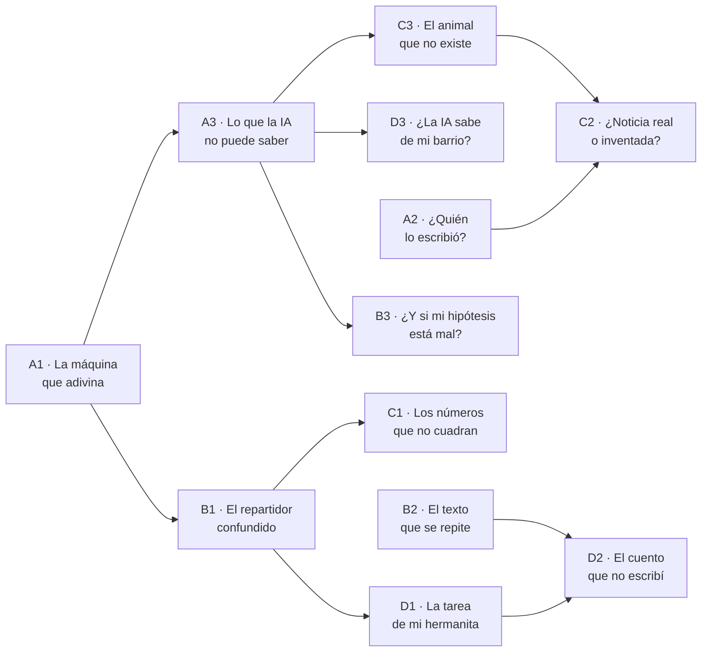

# 08 · Blueprint de contenido — 12 actividades

**Qué es este documento:** la especificación con la que el equipo pedagógico produce las 12
actividades del MVP. Cada ficha contiene todo lo necesario para escribirla, ilustrarla, programarla y
evaluarla — **menos** el texto final de cara al niño, que es trabajo de redacción con revisión
editorial (ADR-008).

**Cobertura:** 4 ejes × 3 áreas (matemáticas, lenguaje, ciencias) = 12 actividades, distribuidas
entre 3.º, 4.º y 5.º.

> ⚠ **`[VERIFICAR — DBA]`** Todas las referencias a Derechos Básicos de Aprendizaje de este documento
> son **propuestas de correspondencia** hechas por el equipo de producto y **deben contrastarse contra
> el documento oficial del MEN por grado y área** antes de producir el contenido. No se citan como
> hechos verificados. Un mapeo curricular incorrecto invalidaría la trazabilidad institucional que es
> parte del valor del producto.

---

## 1. Malla de cobertura

| | Matemáticas | Lenguaje | Ciencias |
|---|---|---|---|
| **Eje A** · ¿Qué es la IA? | A1 · 3.º · *La máquina que adivina* | A2 · 4.º · *¿Quién lo escribió?* | A3 · 5.º · *Lo que la IA no puede saber* |
| **Eje B** · Piensa con la IA | B1 · 4.º · *El repartidor confundido* | B2 · 5.º · *El texto que se repite* | B3 · 5.º · *¿Y si mi hipótesis está mal?* |
| **Eje C** · Detective de IA | C1 · 5.º · *Los números que no cuadran* | C2 · 5.º · *¿Noticia real o inventada?* | C3 · 4.º · *El animal que no existe* |
| **Eje D** · Decide bien | D1 · 4.º · *La tarea de mi hermanita* | D2 · 5.º · *El cuento que no escribí* | D3 · 3.º · *¿La IA sabe de mi barrio?* |

### Distribución por grado y nivel Bloom

| Grado | Actividades | Bloom predominante |
|---|---|---|
| 3.º | A1, D3 | Comprender → Analizar |
| 4.º | A2, B1, C3, D1 | Aplicar → Analizar → Evaluar |
| 5.º | A3, B2, B3, C1, C2, D2 | Analizar → Evaluar → Crear |

> El Eje D alcanza **Evaluar** ya en 3.º (D3) y **Crear** en 5.º (D2), conforme al marco pedagógico.
> Un dilema ético que solo se «comprende» no forma criterio.

### Consumo de LLM

| Tipo | Actividades | Tokens | Offline |
|---|---|---|---|
| Tutor socrático en vivo | B1, B2, B3 | Sí | Degrada a árbol pregrabado |
| Contenido curado, validación local | A1, A2, A3, C1, C2, C3, D1, D2, D3 | **Cero** | Completo |

**9 de 12 actividades no consumen un solo token.** Es la decisión que hace viable el techo de
USD $2/estudiante-mes.

---

## 2. Plantilla de ficha

Cada ficha declara: identificación · trazabilidad pedagógica · situación · interacción · criterios de
logro · comportamiento offline · accesibilidad · notas de producción · riesgos.

---

## EJE A · ¿Qué es la IA y para qué sirve?

---

### A1 · «La máquina que adivina»

| Campo | Valor |
|---|---|
| Grado | 3.º · Área: matemáticas · Tipo: `comparacion` |
| Duración | 8 min · Bloom: **Comprender** |
| PISA | Matemáticas — *Formular situaciones matemáticamente* |
| DBA | `[VERIFICAR — DBA]` Matemáticas 3.º — descripción y extensión de patrones numéricos |
| Offline | Completo · Tokens: cero |

**Situación.** Se presenta una secuencia sencilla (2, 4, 6, 8, …). El estudiante predice el
siguiente número. Luego ve que «la máquina» predice el mismo. Se repite con una secuencia que la
máquina falla porque el patrón cambia a mitad (2, 4, 6, 9, 11, 13, …).

**Interacción.**
1. El niño predice. Registra su respuesta.
2. Ve la predicción de la máquina, dentro de `AIDisclosure`.
3. Se revela el valor real.
4. Pregunta central: *«¿Por qué crees que la máquina se equivocó?»* — 4 opciones ilustradas.
5. Cierre: *«La máquina mira lo que pasó antes para adivinar lo que sigue. Cuando algo cambia, se
   equivoca.»*

**Criterio de logro.** Selecciona una explicación que refiera al cambio del patrón, no a que «la
máquina es tonta» ni a que «se dañó».

**Por qué esta actividad abre todo el producto.** Es la única del conjunto que explica *el mecanismo*
—predecir a partir de lo anterior— en términos que un niño de 8 años puede manipular. Todo el resto
del currículo se apoya en esta intuición: si la IA predice, puede equivocarse, y por eso se comprueba.

**Accesibilidad.** Las secuencias se presentan también como objetos contables ilustrados, no solo
como cifras. TTS lee cada número con pausa.

**Riesgo de producción.** Antropomorfizar. Prohibido escribir «la máquina piensa», «cree» o «quiere».
Verbos permitidos: *adivina, predice, mira, calcula, se equivoca*.

---

### A2 · «¿Quién lo escribió?»

| Campo | Valor |
|---|---|
| Grado | 4.º · Área: lenguaje · Tipo: `clasificacion` |
| Duración | 10 min · Bloom: **Analizar** |
| PISA | Lectura — *Evaluar y reflexionar* |
| DBA | `[VERIFICAR — DBA]` Lenguaje 4.º — comparación de textos según intención y estructura |
| Offline | Completo · Tokens: cero |

**Situación.** Seis textos breves (4–5 líneas) sobre temas escolares colombianos. Tres escritos por
niños reales de 4.º —con sus errores, sus repeticiones y su voz—, tres generados. El estudiante los
clasifica.

**Interacción.**
1. Clasifica cada texto: *lo escribió una persona* / *lo escribió una IA*.
2. **Justificación obligatoria** antes de confirmar (mínimo una señal marcada).
3. Tras cada error, una pista sobre **una** señal observable, sin revelar la respuesta.
4. Cierre: galería con las 6 señales que aparecieron.

**Señales enseñadas.** Repetición de estructura · vocabulario uniformemente correcto · ausencia de
detalle personal concreto · frases que suenan «de adulto» · perfección ortográfica sospechosa ·
generalidad («es muy bonito e interesante»).

**Criterio de logro.** ≥ 4 de 6 correctos **con justificación válida**. Un acierto sin justificación
no cuenta para el dominio (US-02).

**Nota crítica de producción.** Los textos de niños reales requieren **autorización de uso y
anonimización completa**. Si no se consiguen, se escriben imitaciones fieles por el equipo pedagógico
—y se documenta que lo son, porque cambia lo que la actividad realmente enseña.

**Riesgo.** Que las señales se conviertan en reglas rígidas («si no tiene errores, es IA»), lo que
enseñaría a desconfiar de quien escribe bien. **Mitigación obligatoria:** uno de los tres textos
humanos debe estar impecablemente escrito, y el cierre debe nombrar explícitamente que ninguna señal
funciona sola.

---

### A3 · «Lo que la IA no puede saber»

| Campo | Valor |
|---|---|
| Grado | 5.º · Área: ciencias · Tipo: `clasificacion` |
| Duración | 12 min · Bloom: **Evaluar** |
| PISA | Ciencias — *Evaluar y diseñar la indagación científica* |
| DBA | `[VERIFICAR — DBA]` Ciencias 5.º — uso de fuentes y evidencia en la indagación |
| Offline | Completo · Tokens: cero |

**Situación.** Ocho preguntas. El estudiante decide, antes de ver respuesta alguna, si una IA puede
responderlas bien y por qué.

| Pregunta | Puede | Por qué |
|---|---|---|
| ¿Cuántas patas tiene una araña? | Sí | Hecho estable y muy documentado |
| ¿Está lloviendo ahora en mi colegio? | No | Requiere observar el presente |
| ¿Cuál es la capital de Colombia? | Sí | Hecho estable |
| ¿Cómo se llama mi perro? | No | Información que solo el niño tiene |
| ¿Qué pasará mañana en el recreo? | No | El futuro no está en ningún texto |
| ¿Qué es la fotosíntesis? | Sí | Conocimiento documentado |
| ¿Cuántos árboles hay en mi barrio? | No | Requiere ir y contar |
| ¿Le gustó a mi mamá el regalo? | No | Estado interno de otra persona |

**Interacción.** Clasifica cada pregunta y elige la razón entre cuatro categorías: *pasa ahora* ·
*solo yo lo sé* · *hay que ir a ver* · *está en muchos libros*. Cierre: construye con sus propias
palabras la regla general.

**Criterio de logro.** ≥ 6 de 8 correctas y una regla general que distinga conocimiento documentado
de observación directa.

**Conexión.** Es la actividad que fundamenta D3 («¿La IA sabe de mi barrio?») y prepara todo el
Eje C.

---

## EJE B · Pensar con la IA, no por la IA

> Las tres actividades de este eje usan **tutor socrático en vivo** y son las únicas que consumen
> tokens. Cada una requiere, además del system prompt, un **árbol socrático pregrabado** para el modo
> degradado (ADR-005). Doble trabajo de autoría, declarado.

---

### B1 · «El repartidor confundido» ⭐ *actividad de referencia — implementada en el prototipo*

| Campo | Valor |
|---|---|
| Grado | 4.º · Área: matemáticas · Tipo: `tutor_socratico` |
| Duración | 8 min · Bloom: **Evaluar** |
| PISA | Matemáticas — *Interpretar, aplicar y evaluar resultados matemáticos* |
| DBA | `[VERIFICAR — DBA]` Matemáticas 4.º — división como reparto equitativo y verificación del resultado |
| Offline | Degrada a árbol · `forbiddenAnswers`: `["4","cuatro","24/6","24 dividido entre 6"]` |

**Situación.** María tiene 24 arepas para repartir entre 6 amigos en partes iguales. Le preguntó a
una IA y respondió: *«A cada amigo le tocan 5 arepas.»* ¿Tiene razón?

**Interacción.** Diálogo socrático con el widget «Mi comprobación» visible desde el primer segundo.
Ruta de preguntas y system prompt completos en `docs/07-llm-prompts-library.md` §4.

**Criterio de logro.**
- Detecta que la respuesta es incorrecta.
- **Registra un método propio de comprobación** → alimenta la North Star Metric (ISVI).
- Explica por qué está mal en sus palabras.
- Enuncia la generalización: comprobar multiplicando al revés.

**Árbol pregrabado (esquema).**
```
R1  ¿Qué pasaría si le das 5 arepas a cada uno de los 6 amigos?
    ( Sobran ) ( Faltan ) ( Quedan justas )
R2a [Faltan]  → ¿Cuántas repartirías en total?  ( 11 ) ( 30 ) ( 24 )
R2b [Justas]  → Cuenta conmigo: 5, 10, 15, 20, 25, 30. ¿Cuántas tenía María?
R3  [30]      → ¿Y María tenía 30 o 24?
R4            → Entonces, ¿le sobraron o le faltaron arepas a María?
R5            → ¿Cómo repartirías tú para que alcancen justas?
```

**Contexto colombiano.** Arepas, no *pizzas*. El referente importa: la situación debe ser reconocible
en el hogar del estudiante.

---

### B2 · «El texto que se repite»

| Campo | Valor |
|---|---|
| Grado | 5.º · Área: lenguaje · Tipo: `tutor_socratico` |
| Duración | 12 min · Bloom: **Analizar → Crear** |
| PISA | Lectura — *Comprender* + *Evaluar y reflexionar* |
| DBA | `[VERIFICAR — DBA]` Lenguaje 5.º — revisión y reescritura de textos propios y ajenos |
| Offline | Degrada a árbol |

**Situación.** Un párrafo generado por IA sobre el río Magdalena: correcto pero repetitivo, con dos
frases que dicen lo mismo, un adjetivo repetido cuatro veces y una afirmación vaga y grandilocuente.
El estudiante debe mejorarlo.

**Interacción.**
1. Lee el texto dentro de `AIDisclosure`.
2. El tutor pregunta: *«¿Qué le sobra a este texto?»* — nunca lo señala él.
3. El niño marca fragmentos y explica por qué.
4. Reescribe al menos una frase con sus palabras.
5. El tutor pregunta por la afirmación vaga: *«¿Esto dice algo concreto?»*

**Criterio de logro.** Identifica ≥ 2 problemas, reescribe ≥ 1 frase mejorándola de forma verificable
(menor redundancia, mayor concreción), y explica el criterio que usó.

**`forbiddenAnswers`.** No aplica un valor numérico; la restricción es distinta y debe reflejarse en
el prompt: **el tutor nunca reescribe el texto ni propone una versión mejorada.** Solo pregunta.

**Riesgo.** Que el estudiante «mejore» el texto pidiéndoselo al tutor. Mitigación: la reescritura se
captura en un campo separado del chat, y el detector de fuga se configura para marcar cualquier
propuesta de redacción del tutor.

---

### B3 · «¿Y si mi hipótesis está mal?»

| Campo | Valor |
|---|---|
| Grado | 5.º · Área: ciencias · Tipo: `tutor_socratico` |
| Duración | 15 min · Bloom: **Crear** |
| PISA | Ciencias — *Evaluar y diseñar la indagación científica* |
| DBA | `[VERIFICAR — DBA]` Ciencias 5.º — formulación de hipótesis y diseño de experiencias sencillas |
| Offline | Degrada a árbol |

**Situación.** *«¿Por qué se marchitan más rápido las plantas del salón que las del patio?»* El
estudiante formula una hipótesis. La IA propone una explicación **plausible pero no verificable con
los medios del colegio** (p. ej., diferencias de composición del suelo a nivel microscópico).

**Interacción.**
1. El niño escribe su hipótesis.
2. Ve la propuesta de la IA, en `AIDisclosure`.
3. El tutor pregunta: *«¿Cómo podrías comprobar esa idea aquí, en tu colegio?»*
4. Al descubrir que no puede, el tutor pregunta: *«¿Y qué idea sí podrías comprobar?»*
5. El niño diseña un experimento factible: variable, medición, tiempo.

**Criterio de logro.** Distingue una explicación *plausible* de una *comprobable*, y propone un
diseño con al menos una variable, una medición y un plazo.

**Aprendizaje central.** Que una respuesta suene científica no la hace útil. Es la lección de
pensamiento científico más difícil del conjunto y por eso está en 5.º.

**Nota de producción.** Debe existir una **variante sin plantas** para instituciones sin patio ni
materos, usando dos vasos con agua en distinta ubicación. Ningún contenido puede depender de recursos
que la escuela no tenga.

---

## EJE C · Detective de IA

---

### C1 · «Los números que no cuadran»

| Campo | Valor |
|---|---|
| Grado | 5.º · Área: matemáticas · Tipo: `clasificacion` |
| Duración | 12 min · Bloom: **Evaluar** |
| PISA | Matemáticas — *Interpretar, aplicar y evaluar resultados* |
| DBA | `[VERIFICAR — DBA]` Matemáticas 5.º — lectura e interpretación de datos en tablas y gráficos |
| Offline | Completo · Tokens: cero |

**Situación.** Cuatro «datos sorprendentes» presentados como salidas de una IA, con gráfico. Dos son
verdaderos, dos contienen errores detectables **con aritmética de 5.º**: porcentajes que suman 130 %,
y una cifra desproporcionada frente a un referente conocido.

**Interacción.** Marca cada dato como *creíble* / *algo no cuadra*, y en el segundo caso señala qué
específicamente. Retroalimentación con la comprobación aritmética explícita.

**Criterio de logro.** Detecta los 2 errores **y** el método de detección, no solo la intuición.

**Aprendizaje central.** Verificar no siempre exige buscar en otra parte: a veces basta con hacer la
cuenta.

---

### C2 · «¿Noticia real o inventada?»

| Campo | Valor |
|---|---|
| Grado | 5.º · Área: lenguaje · Tipo: `clasificacion` |
| Duración | 12 min · Bloom: **Evaluar** |
| PISA | Lectura — *Evaluar y reflexionar* |
| DBA | `[VERIFICAR — DBA]` Lenguaje 5.º — valoración de la intención y la fuente de los textos |
| Offline | Completo · Tokens: cero |

**Situación.** Tres titulares con su copete: dos de hechos reales del país, uno generado con detalles
inventados sobre un colegio ficticio. El estudiante identifica el falso y lo justifica con **máximo
3 pistas** (el límite obliga a jerarquizar la evidencia).

**Señales enseñadas.** Ausencia de fuente identificable · nombres y lugares que no se pueden
verificar · cifras sin origen · lenguaje excesivamente emocional · fecha imprecisa.

**Criterio de logro.** Identifica el falso **y** menciona ≥ 2 señales válidas.

**Restricción ética de producción.** El colegio ficticio debe ser **inequívocamente ficticio**: nombre
que no corresponda a ninguna institución real, verificado contra el directorio del MEN. La actividad
enseña a detectar noticias falsas; no puede producir una.

**Restricción adicional.** Las noticias reales se seleccionan de hechos neutros y positivos (ciencia,
deporte, cultura). Nada de política, violencia ni tragedias: el objetivo es enseñar verificación, no
exponer a niños de 10 años a contenido perturbador.

---

### C3 · «El animal que no existe»

| Campo | Valor |
|---|---|
| Grado | 4.º · Área: ciencias · Tipo: `clasificacion` |
| Duración | 10 min · Bloom: **Analizar** |
| PISA | Ciencias — *Explicar fenómenos científicamente* |
| DBA | `[VERIFICAR — DBA]` Ciencias 4.º — características y adaptaciones de los seres vivos al entorno |
| Offline | Completo · Tokens: cero |

**Situación.** Seis fichas de animales con imagen y descripción. Cuatro son fauna colombiana real
(oso de anteojos, cóndor, delfín rosado, rana dorada). Dos son generadas: un animal inventado con
descripción convincente, y una imagen real de un animal existente con **descripción inventada**.

**Interacción.** Clasifica y justifica. Pistas progresivas sobre señales visuales (manos y patas
deformadas, texturas repetidas, iluminación inconsistente, fondos que se disuelven) y textuales
(rasgos biológicamente imposibles, hábitats que no corresponden).

**Criterio de logro.** Detecta ambos casos **y** distingue los dos tipos de falsedad: la imagen falsa
y la información falsa sobre una imagen verdadera.

**Aprendizaje central, y la razón de que la actividad exista.** Que la foto sea real no hace real lo
que dice el texto. Es la confusión más frecuente y la más explotada en desinformación.

**Nota de producción.** Las imágenes de fauna real requieren licencia verificada. Las generadas deben
producirse internamente, quedar marcadas con metadatos de origen y **no publicarse fuera de la
plataforma**.

#### Estado real: hay dos versiones, y solo una existe

> ⚠ **C3-texto** está implementada y funcionando. **C3-imagen** está bloqueada por producción de
> activos, no por código.

La versión de la ficha de arriba describe **C3-imagen**. Al implementarla se produjo una
incoherencia: se enseñaban señales visuales («la luz no coincide», «hay texturas que se repiten»)
sobre fichas que solo tenían texto. Un niño no puede juzgar la iluminación de un párrafo, y pedírselo
no enseña: confunde.

| Versión | Enseña | Estado |
|---|---|---|
| **C3-texto** | La mitad textual: afirmaciones imposibles, hábitats que no corresponden, mezclas absurdas, lenguaje vago | ✅ Implementada |
| **C3-imagen** | La mitad visual: manos y patas deformadas, texturas repetidas, iluminación inconsistente, fondos que se disuelven | ⏸ Requiere activos |

**Lo que se conserva sin imágenes.** El aprendizaje central sobrevive en texto: la ficha del colibrí
describe un **animal que sí existe** con afirmaciones falsas (migra a la Antártida, come peces). *Que
el sujeto sea real no hace real lo que se dice de él* — que es exactamente la confusión que la
actividad ataca. Lo que se pierde es la transferencia a imágenes, que es donde el niño se encuentra
la desinformación en su vida real. **Por eso C3-imagen no es opcional: es la mitad que falta.**

#### Producción de activos para C3-imagen

| # | Activo | Cantidad | Requisito |
|---|---|---|---|
| 1 | Fotografías de fauna colombiana real | 4 | Licencia verificada y documentada (banco propio, Creative Commons con atribución, o cesión). Registrar fuente y licencia por imagen |
| 2 | Imagen de un animal inventado, generada | 1 | Producción interna. Debe contener al menos **dos** señales visuales detectables por un niño de 4.º |
| 3 | Fotografía real de un animal existente, con descripción falsa | 1 | Es el ítem clave: imagen legítima + texto inventado |
| — | Metadatos de origen en todas las generadas | — | No se publican fuera de la plataforma |
| — | Texto alternativo descriptivo | 6 | Sin él la actividad es inaccesible; y el alt **no puede delatar** la respuesta |

**Habilitación técnica (ya hecha).** El componente soporta `mediaUrl`; el contenido declara
`signalKind: 'texto' | 'imagen' | 'mixto'`. Cambiar a `'imagen'` **sin adjuntar las seis imágenes
rompe el build**: `apps/api/tests/content-coherence.test.ts` lo impide. Añadir las imágenes será un
cambio de contenido, no de código.

**Decisión pendiente para el equipo pedagógico:** si C3-texto y C3-imagen conviven como dos
actividades del Eje C, o si C3-imagen reemplaza a C3-texto cuando los activos existan. La primera
opción es preferible —son dos competencias distintas— pero suma una actividad al alcance.

---

## EJE D · Ética y responsabilidad

---

### D1 · «La tarea de mi hermanita»

| Campo | Valor |
|---|---|
| Grado | 4.º · Área: matemáticas (transversal) · Tipo: `dilema_ramificado` |
| Duración | 12 min · Bloom: **Evaluar** |
| PISA | Matemáticas — *Formular situaciones* (razonamiento sobre consecuencias) |
| DBA | `[VERIFICAR — DBA]` Competencias ciudadanas 4.º — decisiones y consecuencias en la convivencia |
| Offline | Completo · Tokens: cero |

**Situación.** Tu hermanita de 2.º debe escribir un cuento para mañana. Está llorando porque no se le
ocurre nada. Tú sabes usar la IA. ¿Qué haces?

**Ramificación.**

| Opción | Consecuencia narrativa | Pregunta de segundo orden |
|---|---|---|
| A · La IA escribe el cuento | La profesora pregunta cómo se le ocurrió; la niña no sabe responder | ¿Qué aprendió tu hermanita? |
| B · La IA da ideas, ella escribe | Escribe con dificultad pero es suyo | ¿En qué se diferencia de A? |
| C · La ayudas tú, sin IA | Toma más tiempo; ella participa | ¿Es distinto de B? ¿Por qué? |
| D · Que le pregunte a la profe mañana | Llega sin tarea; la profesora la ayuda | ¿Fue justo con ella? |

**Criterio de logro.** El indicador **no es la opción elegida**, sino la calidad del argumento: que
distinga entre *hacer por* y *ayudar a hacer*, y que reconozca consecuencias más allá de la nota.

**Cierre.** Sin moraleja explícita. Se muestran las cuatro consecuencias y se pregunta: *«¿Cambiarías
tu decisión ahora que viste esto?»* Un dilema que se resuelve con una moraleja deja de ser un dilema.

---

### D2 · «El cuento que no escribí»

| Campo | Valor |
|---|---|
| Grado | 5.º · Área: lenguaje · Tipo: `dilema_ramificado` |
| Duración | 15 min · Bloom: **Crear** |
| PISA | Lectura — *Evaluar y reflexionar* |
| DBA | `[VERIFICAR — DBA]` Lenguaje 5.º — producción textual con propósito y responsabilidad sobre la autoría |
| Offline | Completo · Tokens: cero |

**Situación.** Un estudiante ganó el concurso de cuento del colegio con un texto que escribió con
ayuda de una IA. Un compañero lo descubre. El estudiante debe decidir qué hacer y, después,
**construir la norma**.

**Interacción.**
1. Dilema ramificado con cuatro caminos.
2. **Fase de creación:** el estudiante escribe una regla para su colegio sobre cuándo se puede usar
   IA en un trabajo escolar y cómo debe declararse.
3. Compara su regla con tres reglas propuestas por «otros colegios» (curadas, contrastantes).
4. Revisa su regla si quiere.

**Criterio de logro.** Produce una regla que distinga tipos de uso (idea, corrección, redacción
completa) y que incluya alguna forma de declaración. Es el nivel **Crear** del Eje D.

**Nota de producción.** Las reglas del estudiante son un insumo pedagógico valioso para el docente y
para el proyecto. Se guardan como respuesta de actividad, con las mismas protecciones que el resto de
su trabajo, y **no se publican fuera del curso** sin autorización.

---

### D3 · «¿La IA sabe de mi barrio?»

| Campo | Valor |
|---|---|
| Grado | 3.º · Área: ciencias · Tipo: `comparacion` |
| Duración | 10 min · Bloom: **Evaluar** |
| PISA | Ciencias — *Evaluar y diseñar la indagación científica* |
| DBA | `[VERIFICAR — DBA]` Ciencias 3.º — reconocimiento de los seres vivos del entorno cercano |
| Offline | Completo · Tokens: cero |

**Situación.** El estudiante elige un animal común de su entorno (paloma, mariposa, hormiga, gato,
perro, chulo). Ve una descripción pregenerada y curada, presentada como respuesta de IA: correcta en
lo general, pero **genérica y parcialmente ajena** a su realidad local (habla de estaciones, de
comportamientos que no ocurren en Bogotá, o describe una variedad que no es la de aquí).

**Interacción.**
1. Elige el animal y lee la descripción en `AIDisclosure`.
2. Marca: *esto sí es como aquí* / *esto no es como aquí* / *no sé*.
3. Escribe o dicta una cosa que él sabe por haberlo visto y que la descripción no dice.
4. Cierre: *«Tú sabes cosas de tu barrio que la IA no sabe. ¿Cómo las aprendiste?»*

**Criterio de logro.** Identifica ≥ 1 desajuste y aporta ≥ 1 observación propia. **No se exige
acierto factual**: se valora la comparación entre fuente documental y experiencia directa.

**Por qué esta actividad es importante más allá de su contenido.** Es la única del conjunto donde el
niño es la autoridad y la IA la que no sabe. En un producto sobre IA, con estudiantes de contextos
vulnerables, esa inversión de posiciones es una decisión pedagógica deliberada: el conocimiento
situado del estudiante vale, y el sistema lo dice explícitamente.

**Nota de producción crítica.** Las descripciones son **pregeneradas, revisadas y almacenadas**, no
producidas en vivo. Ningún niño de 3.º interactúa con un modelo en tiempo real en esta actividad.

---

## 3. Requisitos transversales de producción

| # | Requisito | Aplica a |
|---|---|---|
| 1 | Revisión editorial humana antes de publicar; sin revisor, `isPublished = false` | Las 12 |
| 2 | Cierre metacognitivo obligatorio | Las 12 |
| 3 | Todo contenido de IA dentro de `AIDisclosure` | Las 12 |
| 4 | Contexto colombiano en referentes, nombres y lugares | Las 12 |
| 5 | Diversidad en nombres, ilustraciones y roles, sin estereotipos de género, clase o región | Las 12 |
| 6 | Texto completo disponible en TTS | Las 12 |
| 7 | Sin dependencia de recursos que la escuela pueda no tener | Las 12 |
| 8 | Medios con licencia verificada; los generados, marcados en metadatos | A2, C2, C3, D3 |
| 9 | Variante de plan de clase presencial sin tecnología | Las 12 |
| 10 | Árbol socrático pregrabado | B1, B2, B3 |
| 11 | Registro del mapeo PISA/DBA verificado contra fuente oficial | Las 12 |

### Revisión de sesgo — obligatoria antes de publicar

Cada actividad pasa una lista de verificación específica:

- ¿Los nombres representan diversidad real colombiana, sin caricatura?
- ¿Las ilustraciones incluyen distintos tonos de piel, contexturas y capacidades?
- ¿Las situaciones son reconocibles tanto en un contexto urbano acomodado como en uno popular o rural?
- ¿Algún rol (científico, líder, quien resuelve) está asignado sistemáticamente a un mismo perfil?
- ¿Se asume acceso a recursos —viajes, mascotas, dispositivos propios, jardín— que no todos tienen?

---

## 4. Secuencia sugerida



**A1 y A3 son prerrequisitos duros.** Sin la intuición de «predice y por eso falla» y de «hay cosas
que no puede saber», las actividades de detección y de ética se reducen a memorizar señales.

---

<self_critique>

**Debilidad 1 — El mapeo curricular a DBA es una propuesta sin verificar, y sostiene una parte
importante del valor institucional del producto.**
Las doce fichas afirman una correspondencia con Derechos Básicos de Aprendizaje que el equipo no ha
contrastado con el documento oficial del MEN. Está marcado honestamente, pero el problema es de
consecuencia: si el mapeo resulta incorrecto, no se ajusta una etiqueta — puede que la actividad esté
dirigida a un grado equivocado, o que no corresponda a ningún DBA del área y quede pedagógicamente
huérfana. Y es exactamente el punto que un revisor de la SED va a examinar primero.
*Mitigación:* verificar los doce mapeos contra los documentos oficiales por grado y área **antes** de
producir una sola actividad, con revisión de un docente de primaria en ejercicio, y documentar los
casos donde no exista un DBA razonable —admitiendo que la actividad desarrolla una competencia
transversal sin anclaje curricular directo, en vez de forzar una correspondencia.

**Debilidad 2 — Solo tres actividades usan el tutor socrático, que es la propuesta de valor central
del producto.**
Nueve de doce actividades son clasificación, comparación y dilemas con validación determinística. La
decisión es correcta en costo y en robustez offline, pero significa que la mayor parte de la
experiencia del estudiante **no incluye lo que distingue a NativIA de un cuestionario interactivo
bien hecho**. Existe un riesgo real de que la evaluación de impacto termine midiendo el efecto de
actividades de opción múltiple bien diseñadas, y que el tutor —el componente caro, riesgoso y
diferenciador— tenga una dosis demasiado baja para producir efecto detectable.
*Mitigación:* calcular la dosis real de tutor por estudiante en el semestre (turnos × actividades ×
repeticiones) y contrastarla con lo que la literatura sugiere como mínimo para un efecto de
aprendizaje; si resulta insuficiente, incorporar un componente socrático breve —dos o tres turnos— al
cierre de las actividades de los ejes C y D, donde justificar una decisión es pedagógicamente
natural, en lugar de aumentar el número de actividades del eje B.

**Debilidad 3 — Las actividades están especificadas para el estudiante que las completa, no para el
aula que las ejecuta.**
Cada ficha describe una experiencia individual de 8 a 15 minutos, pero ninguna dice qué hace el
docente mientras 32 niños trabajan, cómo se cierra la actividad en grupo, qué se proyecta, ni qué
ocurre con quienes terminan en 4 minutos y con quienes no alcanzan a terminar en 20. En una clase
real de primaria, esa es la diferencia entre una actividad que se usa y una que se abandona tras la
primera sesión.
*Mitigación:* añadir a cada ficha una sección de **puesta en común** —de 5 minutos, con dos preguntas
concretas para el cierre grupal—, una **actividad de extensión** para quienes terminan pronto, y una
regla explícita de qué hacer con los intentos incompletos al final de la clase. Validar las doce en
una observación de aula real antes de darlas por producidas.

</self_critique>
