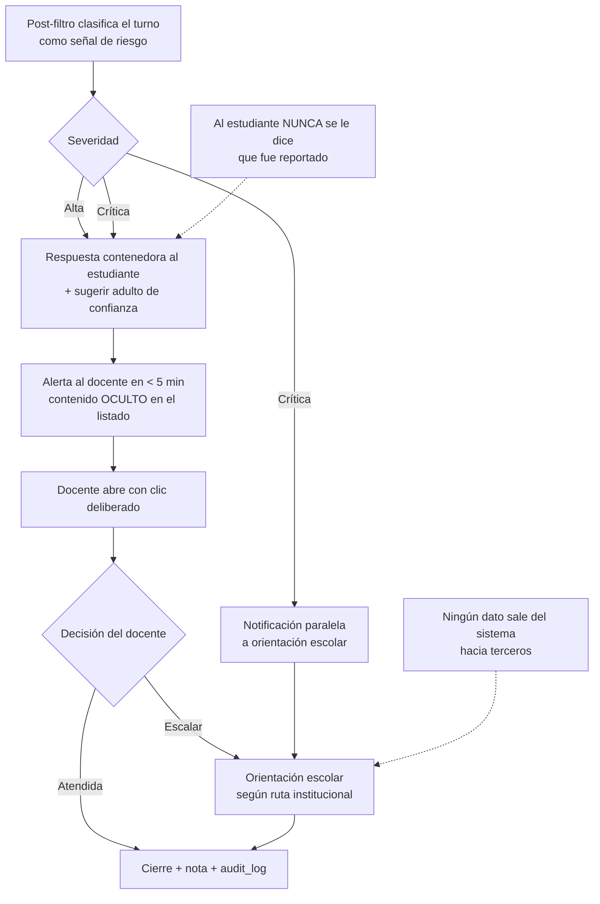

# 10 · Especificación del Panel del Maestro

**Usuaria de referencia:** Prof. Luz Mery, 47 años, 32 estudiantes, todas las áreas, nivel técnico
bajo-medio, **15 minutos libres al día**.

**Criterio de aceptación que gobierna todo el documento:**

> 4 de cada 5 docentes deben identificar correctamente al estudiante que más apoyo necesita, y por
> qué, en **menos de 60 segundos**, sin ayuda y sin formación previa más allá de 2 horas.

Si una función no sobrevive a ese criterio, no entra al panel.

---

## 1. Los tres trabajos del panel

| # | Trabajo | Pregunta del docente | Pantalla |
|---|---|---|---|
| 1 | **Triaje** | ¿A quién atiendo mañana? | Inicio |
| 2 | **Diagnóstico** | ¿Qué le pasa exactamente a este estudiante? | Vista individual + transcripción |
| 3 | **Acción** | ¿Qué hago al respecto, concretamente? | Alertas + banco de planes |

El panel **no** existe para reportar, medir el desempeño docente, ni sustituir el juicio profesional.
Cada dato que se muestra debe responder a uno de esos tres trabajos; si no responde a ninguno, sobra.

### Antirrequisitos explícitos

- ❌ No hay métricas de desempeño **del docente**. El panel nunca compara docentes ni cursos entre sí.
- ❌ No hay tiempo de conexión del estudiante como métrica destacada — mide asistencia, no aprendizaje.
- ❌ No hay ranking de estudiantes.
- ❌ No hay siglas sin glosario en pantalla.
- ❌ No hay más de 3 alertas simultáneas en Inicio.

---

## 2. Arquitectura de la pantalla de Inicio

El wireframe está en `docs/02-information-architecture.md`, pantalla 12. Aquí se especifica el
**contenido y la lógica**, no el layout.

### 2.1 Bloque «Necesitan tu ayuda hoy» — máximo 3 estudiantes

**Función de puntuación de triaje.** Se calcula por estudiante y se ordena descendente; solo se
muestran los 3 primeros con puntaje ≥ 40.

| Componente | Peso | Definición | Rango |
|---|---|---|---|
| `delegacion` | 35 | Proporción de diálogos recientes con aceptación acrítica (ver §4.1) | 0–100 |
| `estancamiento` | 25 | Intentos fallidos consecutivos en la misma subcompetencia | 0–100 |
| `inactividad` | 20 | Días sin actividad, normalizado a 14 días | 0–100 |
| `frustracion` | 15 | Abandonos a mitad de actividad en 7 días | 0–100 |
| `senal_riesgo` | — | **Override:** cualquier señal de riesgo abierta fuerza posición 1 | — |

```
triaje = 0.35·delegacion + 0.25·estancamiento + 0.20·inactividad + 0.15·frustracion
```

> **`delegacion` pesa más que cualquier otro componente por decisión de producto.** Es el hábito que
> el proyecto entero existe para cambiar; el panel debe empujar al docente hacia ese problema, no
> hacia el estudiante que simplemente no entró.

**Regla de redacción:** el motivo se enuncia siempre como **conducta observable, nunca como
atributo del niño**.

| ✅ Se muestra | ❌ Nunca |
|---|---|
| «Lleva 3 actividades aceptando lo que dice la IA sin comprobarlo.» | «Es dependiente de la IA.» |
| «No ha entrado en 8 días.» | «Estudiante desmotivado.» |
| «Se atasca siempre en el mismo paso de división.» | «Bajo desempeño en matemáticas.» |

**Rotación:** un estudiante mostrado y marcado como «atendido» no reaparece por 5 días, salvo que su
puntaje suba ≥ 15 puntos. Sin esta regla, los mismos tres nombres ocupan el panel toda la semana y
el docente deja de mirarlo.

### 2.2 Bloque «Tu grupo esta semana»

Dos barras y una alerta grupal. **No es un gráfico de series ni una tendencia**: es una comparación
de dos magnitudes con nombre propio.

```
Lo que mejor va:   Detectar imágenes hechas por IA     ▓▓▓▓▓▓░  18 de 32 lo manejan
Lo que peor va:    Explicar por qué una cuenta está mal ▓▓░░░░░   6 de 32 lo manejan
```

- La barra usa `eje.{x}-mark` según el eje de la subcompetencia.
- **El número absoluto acompaña siempre a la barra** («18 de 32»). Un docente actúa sobre «6 de 32»,
  no sobre «19 %».
- Extremos, no promedio: el promedio del grupo no sugiere ninguna acción.

### 2.3 Bloque de moderación

Una sola línea con conteo y un botón. No muestra contenido: la pantalla del docente puede estar
proyectada en el salón.

---

## 3. Vista de grupo — heatmap

### 3.1 Especificación de la visualización

| Aspecto | Decisión |
|---|---|
| **Forma** | Matriz de celdas discretas (estudiante × eje). El trabajo es *identidad + magnitud ordinal en dos dimensiones categóricas*: es exactamente el caso del heatmap |
| **Escala** | 3 niveles ordinales, no continua. El docente decide a quién atender, no mide con precisión |
| **Color** | Rampa de un solo tono claro→oscuro, `#8FA9DE / #4A72C6 / #1D428E` (validada; ver `03-design-system.md` §2.3) |
| **Codificación redundante** | Relleno + glifo (`○ ◐ ●`) + trama diagonal en el nivel bajo |
| **Espaciador** | 2 px del color de superficie entre celdas — no borde |
| **Sin datos** | Celda vacía con `–` y `aria-label` «sin actividad todavía»; **nunca** se pinta como "necesita apoyo" |
| **Orden de filas** | Por puntaje de triaje descendente por defecto; alfabético como alternativa |
| **Orden de columnas** | Fijo A→B→C→D, siempre, en todas las vistas |
| **Interacción** | Hover/foco → tooltip con nombre, eje, nivel en palabras y nº de actividades |
| **Alternativa textual** | Botón «Ver como tabla» obligatorio; es la vista que se exporta |
| **Leyenda** | Siempre presente, con glifo + trama + palabra, en el orden de la rampa |

### 3.2 Conmutador de lenguaje

```
Ver por:  [ Ejes de NativIA ▾ ]     ← lenguaje del producto (por defecto)
          [ Competencias PISA   ]   ← lenguaje del reporte institucional
          [ DBA del grado       ]   ← lenguaje del plan de área
```

La misma matriz, tres vocabularios. Resuelve una tensión real: el docente piensa en «Detective de
IA», pero su coordinador le pide evidencia en «evaluar y reflexionar». Con un clic obtiene ambos, sin
tener que traducir.

Cada término del modo PISA/DBA lleva `ⓘ` con su definición en una frase.

---

## 4. Definiciones de métricas

Toda métrica del panel se define aquí de forma operacional. **Ninguna métrica sin definición en esta
sección puede mostrarse en la interfaz.**

### 4.1 `aceptacion_acritica`

Un turno de diálogo cuenta como aceptación acrítica cuando **todas** se cumplen:

1. El turno anterior del tutor presentó o refirió una afirmación atribuida a la IA.
2. La respuesta del estudiante expresa acuerdo o avance («sí», «ok», «está bien», «entonces es 5»).
3. **No** enuncia ningún procedimiento de verificación (recalcular, contar, contrastar, otra fuente).
4. No hay registro en «Mi comprobación» dentro del mismo intento.

Clasificado por `claude-haiku-4-5` con un prompt de clasificación de una sola etiqueta (ver
`07-llm-prompts-library.md`), validado contra codificación humana en el 10 % de los casos.
**κ objetivo ≥ 0,75; por debajo, la métrica se retira del panel hasta recalibrar.**

Mostrado al docente como: *«aceptó lo que dijo la IA sin comprobarlo»*.

### 4.2 `dominio` (nivel del heatmap)

Estimado con **Bayesian Knowledge Tracing** por subcompetencia:

| Parámetro | Valor inicial | Nota |
|---|---|---|
| `p_init` (conocimiento previo) | 0,25 | `[SUPUESTO]` — recalibrar con datos del piloto |
| `p_learn` (transición) | 0,15 | por oportunidad de práctica |
| `p_slip` (error por descuido) | 0,10 | |
| `p_guess` (acierto por azar) | 0,20 | 0,05 en ítems abiertos |

| Nivel mostrado | `p(dominio)` | Requisito adicional |
|---|---|---|
| Lo maneja bien | ≥ 0,80 | ≥ 3 oportunidades de práctica |
| Va en camino | 0,40 – 0,79 | ≥ 2 oportunidades |
| Necesita apoyo | < 0,40 | ≥ 2 oportunidades |
| Sin datos | — | < 2 oportunidades → celda vacía |

> **La regla de mínimo de oportunidades no es negociable.** Pintar «necesita apoyo» a partir de un
> solo intento produce un diagnóstico falso que el docente puede llevarse a una reunión con la
> familia.

**Un acierto sin justificación válida no incrementa el dominio** en los ejes C y D (requisito US-02).

### 4.3 `tipologia_de_error`

Clasificación mostrada en la vista individual:

| Código | Etiqueta para el docente | Se detecta cuando |
|---|---|---|
| `E1` | «Acepta sin comprobar» | Cumple §4.1 |
| `E2` | «Detecta el error pero no lo explica» | Marca correctamente y falla la justificación |
| `E3` | «Se atasca en un paso concreto» | Mismo paso fallido ≥ 3 veces |
| `E4` | «Adivina» | Cambia de respuesta sin cambiar de razonamiento |
| `E5` | «Busca la respuesta directa» | ≥ 3 peticiones de respuesta en una sesión |
| `E6` | «Abandona cuando se pone difícil» | Sale tras el primer turno socrático, ≥ 3 veces |

Cada tipología tiene **una acción sugerida** asociada en el banco de planes de clase. Una tipología
sin acción asociada no se muestra: describir un problema sin ofrecer salida aumenta la carga del
docente en vez de reducirla.

### 4.4 Métricas explícitamente excluidas

| Métrica | Por qué no se muestra |
|---|---|
| Tiempo total conectado | Mide asistencia, no aprendizaje; se presta a control indebido |
| Velocidad de respuesta | Penaliza al estudiante que piensa |
| Comparación con el promedio del curso | Empuja a la comparación entre niños |
| Número de mensajes al tutor | Más turnos puede ser mejor o peor; no es interpretable solo |
| Puntaje único de "nivel IA" del estudiante | Un número que resume a un niño se convierte en etiqueta |

---

## 5. Motor de alertas

### 5.1 Catálogo

| Código | Tipo | Disparador | Severidad | Acción ofrecida |
|---|---|---|---|---|
| `A-RIESGO` | Individual | Señal de riesgo clasificada (bullying, autolesión, abuso, datos sensibles) | 🔴 Crítica | Revisar + protocolo institucional |
| `A-DELEG` | Individual | `aceptacion_acritica` ≥ 0,6 en los últimos 5 diálogos | 🟡 Media | Ver conversación + actividad de refuerzo |
| `A-EVASION` | Individual | ≥ 3 intentos de obtener la respuesta directa en una sesión | 🟡 Media | Ver conversación + conversar |
| `A-INACT` | Individual | ≥ 7 días sin actividad con autorización vigente | 🟡 Media | Ver detalle |
| `A-ATASCO` | Individual | Misma subcompetencia fallida ≥ 4 veces en 10 días | 🟡 Media | Plan de clase específico |
| `A-GRUPO` | Grupal | ≥ 5 estudiantes (o ≥ 30 % del curso) fallan la misma subcompetencia en 7 días | 🟡 Media | Plan de clase grupal |
| `A-CONSENT` | Administrativa | Autorización pendiente > 10 días | ⚪ Baja | Reenviar comunicación |
| `A-DEGRAD` | Sistema | > 40 % de los diálogos del curso en modo degradado en 7 días | ⚪ Baja | Informar a coordinación (conectividad) |

### 5.2 Reglas de gobierno del motor

1. **Techo de 3 alertas visibles en Inicio.** El resto vive en la pestaña Alertas.
2. **Prioridad:** 🔴 siempre primero, luego por recencia dentro de cada severidad.
3. **Supresión de duplicados:** una alerta del mismo código y sujeto no se repite en 5 días.
4. **Aprendizaje del descarte:** «No aplica» ajusta el umbral de ese código **para ese docente**. Tres
   descartes consecutivos del mismo código elevan su umbral un 20 %.
5. **Sin alerta sin acción.** Toda alerta enlaza a algo concreto. Sin acción disponible, no se emite.
6. **Las alertas 🔴 nunca se auto-descartan** ni caducan; solo un humano las cierra, y el cierre queda
   en el `audit_log`.

### 5.3 Protocolo de la alerta de riesgo



> `[SUPUESTO — BLOQUEANTE ANTES DEL PILOTO]` La ruta de escalamiento a orientación escolar debe
> alinearse con el protocolo vigente de la SED y del manual de convivencia de cada institución. El
> sistema **no puede** definir esa ruta por su cuenta: la parametriza por institución.

---

## 6. Vista individual

### 6.1 Jerarquía de contenido

| Orden | Bloque | Por qué en esa posición |
|---|---|---|
| 1 | Resumen de 30 días (actividades, tiempo, días activos) | Contexto en una línea |
| 2 | **«Lo que más preocupa»** + acción sugerida | Es la razón por la que el docente abrió la pantalla |
| 3 | Dominio por eje (4 barras) | Panorama |
| 4 | Últimas conversaciones con marca de tipología | Ruta al diagnóstico profundo |
| 5 | **Respuestas metacognitivas literales** | El dato más rico del sistema |

### 6.2 Sobre el bloque 5

Las respuestas a «¿qué aprendiste sobre cómo TÚ piensas?» se muestran **textuales, sin resumir, sin
corregir ortografía y sin análisis automático**. La frase de un niño de 9 años —«aprendí que a veces
la ia se equivoca pero yo igual le creo»— comunica al docente algo que ningún indicador captura.
Procesarlas destruiría precisamente lo que las hace valiosas.

---

## 7. Transcripciones y auditoría

| Regla | Implementación |
|---|---|
| Acceso limitado | Solo el docente a cargo del curso y orientación escolar bajo protocolo |
| Sin acceso de rectoría | Decisión permanente (PRD, R-04 *Won't*) |
| Auditoría de acceso | Cada apertura registra `actor`, `sujeto`, `timestamp`, `motivo` en `audit_log` |
| Aviso al docente | «Tu consulta de esta conversación queda registrada» al pie de cada transcripción |
| Aviso al estudiante | Pantalla 10, antes de que lo descubra por su cuenta |
| Sin edición | Las transcripciones son inmutables; solo se pueden anotar |
| Retención | Igual que el resto de datos del estudiante (`09-security-privacy-plan.md`) |

**Marcas visibles en la transcripción:** `⚑ pidió respuesta` · `⚑ aceptó sin comprobar` ·
`⚑ moderación` · `⚑ modo degradado`.

---

## 8. Banco de planes de clase

Cada plan es contenido curado por el equipo pedagógico. **No se generan con IA en producción.**

### Esquema obligatorio

| Campo | Regla |
|---|---|
| Título | ≤ 6 palabras, en lenguaje de aula |
| Duración | Minutos reales, no rango |
| Grados | Explícito |
| **Materiales** | Campo prioritario. «Ninguno» es el valor preferido |
| Eje y competencia PISA/DBA | Para trazabilidad institucional |
| Tipología de error que atiende | `E1`…`E6` — es lo que permite recomendarlo automáticamente |
| Pasos | Máximo 5, numerados, en imperativo |
| Qué observar | 2–3 señales concretas de que está funcionando |
| Variante sin tecnología | **Obligatoria.** Todo plan debe poder ejecutarse sin dispositivos |

> La variante sin tecnología no es un extra: es lo que hace que el plan se use el día que el
> internet no sirve, que es un día frecuente.

---

## 9. Rendimiento y comportamiento

| Requisito | Umbral |
|---|---|
| Carga de Inicio con 32 estudiantes | < 1,5 s |
| Carga del heatmap | < 1,5 s |
| Carga de transcripción | < 1 s |
| Frescura de los datos | ≤ 15 min; se indica en pantalla la hora del último cálculo |
| Latencia de alerta 🔴 | < 5 min desde el turno |
| Sin conexión | Última vista cacheada + banner «datos de hace N minutos» |
| Exportación PDF | < 10 s, generada en servidor |

**Estrategia de cálculo:** las métricas se materializan en una tabla de resumen por curso, refrescada
cada 15 minutos y ante eventos 🔴. El panel **nunca** consulta la tabla de eventos en tiempo real:
con 32 estudiantes funcionaría, con 300.000 no, y reescribirlo después es más caro que hacerlo bien
ahora.

---

## 10. Formación y adopción

| Momento | Duración | Contenido |
|---|---|---|
| Inducción | 2 h | Los 4 ejes, el criterio de los 60 s, qué NO hace el panel, protocolo de riesgo |
| Primera semana | — | Recorrido guiado de 4 pasos dentro del producto, omitible |
| Semana 3 | 45 min | Sesión de dudas con casos reales del propio curso |
| Continuo | — | Cada alerta enlaza a una explicación de una frase de por qué se generó |

**Señal de fracaso a vigilar:** si tras 3 semanas menos del 50 % de los docentes abre el panel
semanalmente, el problema es el panel, no el docente. Rediseño, no más capacitación.

---

<self_critique>

**Debilidad 1 — El puntaje de triaje pondera métricas de fiabilidad muy desigual.**
`delegacion` pesa 35 % y depende de un clasificador de LLM cuya concordancia con codificación humana
todavía no se ha medido; `inactividad` pesa 20 % y es un conteo exacto. En la práctica el orden de
los tres nombres que ve el docente puede depender del ruido del componente menos confiable, y ese
orden determina a qué niño se le presta atención mañana.
*Mitigación:* no exponer `delegacion` en el triaje hasta alcanzar κ ≥ 0,75 contra codificación
humana; hasta entonces, opera con los otros tres componentes renormalizados. Mostrar en la interfaz
del docente el nivel de confianza de la señal («esto lo detectó el sistema automáticamente, revísalo»)
y registrar cuántas veces el docente marca «no aplica» sobre alertas `A-DELEG` como medida continua
de calidad del clasificador.

**Debilidad 2 — El panel asume un docente por curso, y la primaria colombiana no siempre funciona así.**
Toda la especificación —permisos, alertas, transcripciones, planes— cuelga de la relación
«docente titular ↔ curso». No está resuelto qué ocurre con docentes de apoyo, orientadores, docentes
de área que rotan entre cursos, reemplazos temporales, ni con un coordinador que legítimamente
necesita ver un caso individual para acompañar al docente. Al desplegarse, esos casos se resolverán
de forma improvisada, probablemente compartiendo credenciales — que es el peor resultado posible para
un sistema que custodia conversaciones de menores.
*Mitigación:* modelar explícitamente `ClassroomAssignment` con roles (titular, apoyo, orientación,
reemplazo) y vigencia temporal, definir la matriz de permisos por rol antes del MVP, e incluir el
caso «acompañamiento de coordinación» con acceso individual **con justificación obligatoria** y
registro reforzado en el `audit_log`, en lugar de negarlo y provocar que se sortee.

**Debilidad 3 — El criterio de los 60 segundos está declarado pero no está instrumentado.**
Es el criterio que gobierna el documento entero y no existe forma prevista de medirlo en producción:
no se registran los eventos que permitirían saber cuánto tarda un docente real desde que abre el
panel hasta que toma una decisión. Sin esa medición, el criterio queda como una intención que se
evaluará una sola vez en un test de usabilidad de 5 personas y nunca más.
*Mitigación:* instrumentar el embudo «apertura de Inicio → primer clic en una acción sugerida» como
métrica continua del panel, con su mediana publicada en el tablero interno del equipo, y establecer
que una mediana superior a 90 segundos durante dos semanas dispara una revisión de diseño. Es la
misma disciplina que el documento exige para las métricas de aprendizaje.

</self_critique>
