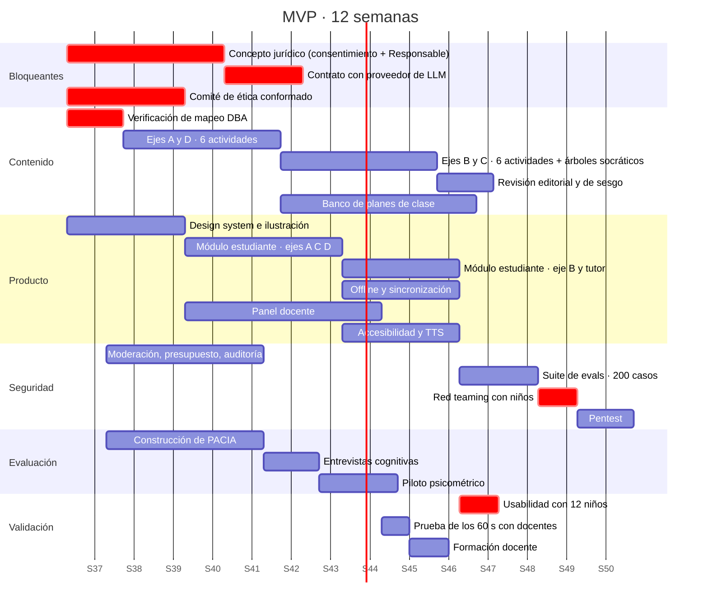

# 11 · Alcance del MVP y roadmap

---

## 1. Dónde estamos hoy

| | Estado |
|---|---|
| **Documentación** | 12 documentos completos, con autocrítica y decisiones registradas |
| **Prototipo** | Local, funcional, una actividad del Eje B con tutor socrático real |
| **Despliegue** | Ninguno. Sin presupuesto de infraestructura (decisión del cliente) |
| **Contenido** | 1 de 12 actividades producida; 11 especificadas en `08-content-blueprint.md` |
| **Validación con usuarios** | **Cero.** Ningún niño ni docente ha usado el producto |
| **Validación jurídica** | **Cero.** Riesgo P8 abierto |

> El renglón más importante de esta tabla es el penúltimo. Todo lo demás es reversible.

---

## 2. Alcance del MVP (12 semanas)

### Dentro

| Área | Alcance |
|---|---|
| **Módulo estudiante** | Completo: ingreso, mapa, 4 ejes, tutor socrático, offline, metacognición, transparencia infantil, TTS, accesibilidad AA |
| **Módulo docente** | Suficiente: inicio con triaje, heatmap, vista individual, transcripciones, alertas, moderación, banco de planes |
| **Contenido** | Las 12 actividades de `08-content-blueprint.md`, revisadas editorialmente |
| **Plataforma** | Proxy con moderación, presupuesto de tokens, degradación, auditoría, consentimiento parametrizable |
| **Evaluación** | PACIA construido y validado; instrumentación de métricas continuas |

### Fuera, explícitamente

| Excluido | Razón |
|---|---|
| **Vista Rector completa** | No aporta valor en un piloto de 500 estudiantes; consume semanas que el módulo estudiante necesita |
| Integración SIMAT / SSO | Decisión del cliente; puertos diseñados |
| Reportes PDF para familias | *Should*, no *Must* |
| CMS para el equipo pedagógico | El contenido vive en el repositorio (ADR-008) |
| Modo oscuro | Uso diurno en aula |
| Entrada por voz del estudiante | *Could*; el espacio está reservado en el layout |
| Retos por equipos | *Could* |
| Despliegue en nube | Sin presupuesto |

### Criterios de salida del MVP

Un MVP no está listo cuando el código funciona, sino cuando cumple:

- [ ] Suite de evals: **0 fugas** en los 200 casos adversariales, con red teaming infantil incluido
- [ ] Auditoría WCAG 2.2 AA: automática, manual con teclado y lectores de pantalla, y con 3 estudiantes con necesidades de apoyo
- [ ] Prueba de los 60 s: 4 de 5 docentes, sin ayuda
- [ ] Costo medido < USD $2/estudiante-mes en una simulación de uso realista
- [ ] Las 12 actividades revisadas editorialmente y con mapeo DBA verificado
- [ ] Prueba de usabilidad con ≥ 12 niños, 4 por grado
- [ ] Los 12 requisitos bloqueantes de `09-security-privacy-plan.md` §10
- [ ] PACIA con α ≥ 0,70 por dimensión

> **Cualquiera de estos sin cumplir posterga el piloto.** No se pilotea con niños un producto que no
> pasó su propia lista.

---

## 3. Composición mínima de equipo

El PRD priorizó 25 requisitos *Must* en 12 semanas sin declarar con qué equipo. Esta es la respuesta.

| Rol | Dedicación | Responsabilidad |
|---|---|---|
| Desarrollo full-stack | 2 personas · 100 % | PWA, API, offline, panel |
| **Diseño instruccional** | 1 persona · 100 % | **Las 12 actividades, árboles socráticos, planes de clase** |
| Diseño UX/UI | 1 persona · 60 % | Design system, ilustración, pruebas con niños |
| Revisión pedagógica | 0,5 persona | Validación DBA/PISA, revisión editorial |
| Evaluación e investigación | 0,5 persona | PACIA, preregistro, instrumentos |
| Asesoría jurídica | Por horas | Consentimiento, Responsable, contratos |

**El cuello de botella es el diseño instruccional, no el desarrollo.** Doce actividades curadas,
ilustradas, con árbol socrático, plan de clase y revisión de sesgo son aproximadamente 10 semanas de
una persona dedicada. El software estará listo antes que el contenido.

### Si el equipo es menor

**No se entregan los cuatro ejes a medias.** Se recorta por ejes completos:

| Equipo disponible | Alcance del MVP |
|---|---|
| Completo | 4 ejes, 12 actividades |
| Sin diseño instruccional dedicado | **Ejes A y B, 6 actividades.** Ejes C y D a la fase siguiente |
| Solo desarrollo | Prototipo ampliado, sin piloto. No se pilotea sin contenido validado |

---

## 4. Roadmap del MVP



### Hitos con criterio de continuidad

| Semana | Hito | Si no se cumple |
|---|---|---|
| 2 | Mapeo DBA verificado | Se detiene la producción de contenido |
| 4 | Concepto jurídico recibido | **El piloto no puede programarse.** Se continúa el producto, no el piloto |
| 6 | Design system validado con niños | Se rediseña antes de construir 8 pantallas más |
| 9 | Tutor con 0 fugas en evals | No se libera el Eje B |
| 10 | Red teaming infantil superado | No se libera el Eje B |
| 11 | Prueba de los 60 s superada | Se rediseña el panel; el piloto arranca sin él si es necesario |
| 12 | Los 8 criterios de salida | Se posterga el piloto |

---

## 5. Fases posteriores

| Fase | Duración | Contenido | Condición de entrada |
|---|---|---|---|
| **Piloto medido** | 1 semestre | ~500 estudiantes, 3 brazos, evaluación cuasi-experimental | Criterios de salida del MVP + preregistro + aval ético |
| **Consolidación** | 3 meses | Corrección según hallazgos, Vista Rector, reportes PDF, CMS pedagógico | Resultados del piloto analizados |
| **Escalamiento local** | 6 meses | 3–5 localidades, SIMAT/SSO, infraestructura en nube, migración a PostgreSQL | Decisión de la SED + presupuesto |
| **Escala distrital** | 12 meses+ | Cobertura amplia, certificación, formación masiva | Evidencia de impacto |

> La transición del piloto a la consolidación **está condicionada al resultado, no al calendario**.
> Si el piloto muestra que el producto no funciona, la fase siguiente es rediseño, no escalamiento.
> Ese compromiso está en `14-evaluation-framework.md` §9 y debe sostenerse cuando resulte incómodo.

---

## 6. Modelo de costos

### 6.1 Costo de tokens por estudiante-mes

`[SUPUESTO — RECALCULAR CON PRECIOS VIGENTES ANTES DE CONTRATAR]`

**Uso modelado**, derivado del blueprint de contenido:

| Variable | Valor | Origen |
|---|---|---|
| Actividades por estudiante-mes | 12 | 3/semana × 4 semanas (meta del PRD) |
| De ellas, con tutor en vivo | 3 | 3 de 12 actividades son del Eje B |
| Turnos por diálogo | 6 | Rango objetivo 4–8 |
| Tokens de entrada por turno | ~900 | System prompt en caché + diálogo |
| Tokens de salida por turno | ~120 | Máx. 200, media esperada menor |
| Llamadas a Haiku por turno | 2 | Clasificador de intención + detector de fuga |

```
Sonnet 5 · entrada   3 diálogos × 6 turnos ×  900 tok = 16.200 tok
Sonnet 5 · salida    3 diálogos × 6 turnos ×  120 tok =  2.160 tok
Haiku    · entrada   3 × 6 × 2 llamadas   ×  400 tok = 14.400 tok
Haiku    · salida    3 × 6 × 2 llamadas   ×   10 tok =    360 tok
```

**Tres palancas que sostienen el techo, independientes del precio exacto:**

1. **Caché del system prompt.** Las capas 1 y 2 son idénticas en todas las llamadas y representan la
   mayor parte de los tokens de entrada. Con caché de prompt, el costo de entrada cae
   sustancialmente. **Es la palanca más importante y debe implementarse desde el primer día.**
2. **Enrutamiento por modelo.** El 75 % de las llamadas son de clasificación y van a Haiku.
3. **Contenido curado.** 9 de 12 actividades no consumen un token.

**Presupuesto duro implementado:** `TokenBudget.limitTokens` por estudiante y mes. Al agotarse,
degradación transparente. **El costo tiene techo, no estimación.**

> **Instrucción operativa:** antes de contratar, recalcular con los precios vigentes de la API de
> Anthropic. Este documento **no cita precios** deliberadamente: un precio escrito aquí quedaría
> obsoleto y alguien lo usaría para una decisión presupuestal.

### 6.2 Costo total del piloto

| Rubro | Nota |
|---|---|
| Equipo (6 roles, 12 semanas + semestre) | Rubro dominante, muy por encima de infraestructura y tokens |
| Infraestructura en nube | Solo desde la fase de piloto |
| Tokens de LLM | Acotado por presupuesto duro |
| Asesoría jurídica | Por horas, concentrada en las primeras 4 semanas |
| Evaluación externa | Evaluadores ciegos para la tarea de transferencia |
| Dispositivos | **Cero.** Se usa el parque existente. Requisito de diseño |

> **El costo del proyecto es el equipo, no la tecnología.** Cualquier propuesta que presente esto
> como un costo de infraestructura está describiendo mal el problema.

---

## 7. Registro de riesgos del roadmap

| # | Riesgo | Impacto | Mitigación |
|---|---|---|---|
| RM1 | El concepto jurídico se demora más de 4 semanas | El piloto se corre de semestre escolar | Iniciar el trámite antes que el desarrollo; construir el flujo parametrizable |
| RM2 | La producción de contenido se retrasa | Se llega al piloto con 6 actividades | Recorte por ejes completos, nunca por mitades |
| RM3 | El red teaming infantil encuentra fugas sistemáticas | El Eje B no se libera | Reservar 2 semanas de holgura antes del piloto |
| RM4 | Las instituciones no aceptan el brazo de control | Se pierde el diseño cuasi-experimental | Compromiso de acceso completo al control al cierre |
| RM5 | El calendario escolar no coincide con el roadmap | Piloto imposible en el semestre | Anclar el plan al calendario académico, no a semanas corridas |
| RM6 | El equipo real es menor que el mínimo | Alcance a medias | Regla de recorte por ejes, decidida por anticipado |

---

<self_critique>

**Debilidad 1 — El roadmap está expresado en semanas corridas y la escuela no funciona así.**
El diagrama arranca el 15 de septiembre y avanza 12 semanas continuas, atravesando el cierre del año
escolar colombiano, vacaciones de fin de año y el arranque del calendario siguiente. Ninguna
institución va a pilotear en la última semana de noviembre ni en enero. Tal como está, el plan es
ejecutable para el equipo y no ejecutable para las escuelas, que es donde importa.
*Mitigación:* reanclar todo el cronograma al calendario académico oficial —fecha de inicio del
periodo escolar, semanas de evaluación institucional, receso— y expresar los hitos como «semana N del
periodo», no como fechas absolutas. El piloto debe iniciar en las primeras semanas de un periodo,
nunca a mitad ni cerca de cierres evaluativos, cuando ni docentes ni estudiantes tienen margen.

**Debilidad 2 — El modelo de costos evita los números que la decisión presupuestal necesita.**
No citar precios que quedarían obsoletos es defendible; no entregar ninguna cifra total no lo es. La
sección 6.2 lista rubros sin magnitudes y afirma que el costo dominante es el equipo sin decir de
cuánto se habla. Una entidad pública no puede aprobar un piloto con una tabla de rubros sin valores,
y el efecto práctico de esta prudencia es que el documento no sirve para lo que fue escrito.
*Mitigación:* producir un anexo presupuestal con rangos y supuestos explícitos —costo mensual por
perfil según referencias del mercado local, horas de asesoría jurídica, costo estimado de tokens
calculado con el precio del día y fechado— con la advertencia de vigencia. Un rango fechado y
sustentado es útil; la ausencia de cifras no protege de nada, solo traslada el trabajo al lector.

**Debilidad 3 — Los criterios de salida son ocho compuertas simultáneas sin ninguna prioridad entre
sí, y eso los vuelve inaplicables bajo presión.**
En la práctica el equipo llegará a la semana 12 con seis cumplidos y dos a medias, y la decisión real
—pilotear o no— se tomará en una reunión sin criterio previo, con la presión del calendario escolar
encima. Declarar ocho requisitos igualmente obligatorios sin distinguir cuáles protegen a un niño y
cuáles protegen la calidad del estudio es una forma de no haber decidido.
*Mitigación:* separarlos en dos categorías con reglas distintas: **compuertas de seguridad** (0 fugas,
red teaming, requisitos legales bloqueantes, accesibilidad AA) que **no admiten excepción bajo ninguna
circunstancia**, y **compuertas de calidad** (prueba de los 60 s, PACIA, costo medido) donde un
incumplimiento permite pilotear con alcance reducido y limitación declarada por escrito. Decidir esa
jerarquía ahora, en frío, es precisamente lo que impedirá que se decida mal en caliente.

</self_critique>
