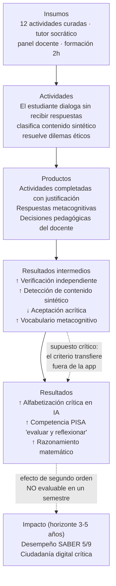

# 14 · Marco de evaluación de impacto

**Pregunta que este documento responde:** ¿cómo sabremos si NativIA realmente enseña a los niños a
pensar con la IA, y no solo si les gustó la app?

---

## 1. Principio rector

> Una app educativa que solo mide compromiso (*engagement*) mide su propio éxito comercial, no el
> aprendizaje. NativIA se evalúa con **una métrica que puede desmentirlo**.

Este marco se compromete con tres reglas:

1. **Toda hipótesis se preregistra** antes de recoger datos, con su análisis definido. Sin
   preregistro no hay resultado publicable ni reportable al Distrito.
2. **Existe un indicador antagónico** cuya alza refuta el producto aunque todo lo demás mejore.
3. **No se prometerá al Distrito mejora en SABER 5 dentro del piloto.** La transferencia a puntajes
   estandarizados es un efecto de segundo orden con horizonte de años; prometerla sería deshonesto y
   pondría en riesgo la credibilidad del proyecto.

---

## 2. Teoría del cambio



### Supuestos críticos que el piloto debe poner a prueba

| # | Supuesto | Cómo se pone a prueba | Si es falso |
|---|---|---|---|
| S1 | El diálogo socrático no frustra a niños de 8–9 años hasta el abandono | Tasa de abandono a mitad de actividad por grado + observación de aula | Andamiaje mucho más fuerte en 3.º, o reservar eje B para 4.º–5.º |
| S2 | El criterio aprendido transfiere a situaciones fuera de la app | Tarea de transferencia con estímulos nuevos, no vistos, aplicada 4 semanas después | El producto enseña a superar la app, no a pensar: rediseño del eje B |
| S3 | El docente usa el panel para tomar decisiones | Log de uso + entrevista sobre decisiones concretas tomadas | El circuito pedagógico está roto; rediseñar el panel o el modelo de formación |
| S4 | El efecto no se explica solo por novedad tecnológica | Comparación con grupo control activo (ver §4) | El efecto es Hawthorne, no pedagógico |

---

## 3. Constructo e instrumento

### 3.1 Definición operacional de "alfabetización crítica en IA" (8–11 años)

Cuatro dimensiones, alineadas con los ejes del producto:

| Dim. | Nombre | Definición operacional | Eje |
|---|---|---|---|
| **D1** | Comprensión funcional | Reconoce qué puede y qué no puede hacer un sistema de IA; distingue "sabe" de "predice texto plausible" | A |
| **D2** | Verificación | Ante una afirmación de IA, ejecuta al menos un procedimiento propio de comprobación antes de aceptarla | B |
| **D3** | Detección | Identifica señales observables de contenido sintético y justifica su juicio | C |
| **D4** | Juicio ético | Evalúa situaciones de uso de IA considerando honestidad, privacidad y equidad, y argumenta su posición | D |

### 3.2 Instrumento: **PACIA** (Prueba de Alfabetización Crítica en IA)

`[DATO A VERIFICAR]` No se identificó un instrumento validado en español para esta franja etaria.
**Consecuencia:** hay que construirlo, y su construcción es un entregable del piloto tan importante
como el software.

**Especificación:**

- **Formato:** 24 ítems (6 por dimensión), 20–25 minutos, aplicable en tableta o en papel.
- **Tipos de ítem:** selección múltiple con justificación, clasificación con evidencia, y 2 ítems
  abiertos por dimensión con rúbrica de 4 niveles.
- **Versiones paralelas A y B** (pre/post) para controlar efecto de práctica, con equivalencia
  verificada por TRI o, si la muestra es insuficiente, por diseño balanceado de dificultad.
- **Lectura:** todos los ítems disponibles en audio; el instrumento mide criterio sobre IA, **no
  competencia lectora**. Este es el mayor riesgo de validez del instrumento.
- **Contextualización:** estímulos con referentes colombianos (fauna, geografía, escuela), evitando
  ventaja para estudiantes con mayor exposición a contenido internacional.

**Proceso de validación mínimo antes del piloto:**

1. **Validez de contenido:** 5 jueces expertos (2 didáctica de las ciencias, 1 lenguaje, 1 ética
   digital, 1 docente de primaria en ejercicio). Criterio de retención: V de Aiken ≥ 0,80 por ítem.
2. **Validez aparente y comprensibilidad:** entrevistas cognitivas (*think-aloud*) con 10 niños,
   3–4 por grado. Reescritura de todo ítem que 3 o más niños interpreten distinto de lo previsto.
3. **Piloto psicométrico:** aplicación a ~150 estudiantes no participantes del estudio.
   Criterios: α de Cronbach ≥ 0,70 por dimensión; discriminación del ítem ≥ 0,25; análisis factorial
   confirmatorio de la estructura de 4 dimensiones.
4. **Confiabilidad inter-jueces** en ítems abiertos: κ de Cohen ≥ 0,75 con doble corrección ciega
   del 20 % de los protocolos.

> **Si el instrumento no alcanza estos umbrales, el piloto se reporta como estudio de factibilidad,
> no como evaluación de eficacia.** Reportar un efecto medido con un instrumento no validado es peor
> que no reportar nada.

### 3.3 Medidas complementarias

| Medida | Instrumento | Momento |
|---|---|---|
| Competencia PISA por área | Ítems liberados PISA adaptados + ítems propios | Pre / post |
| Mastery por subcompetencia | *Bayesian Knowledge Tracing* sobre `AttemptEvent` | Continuo |
| Delegación acrítica | Ítems trampa embebidos (ver §6) | Continuo |
| Uso y compromiso | Telemetría de producto | Continuo |
| Autoeficacia y actitud hacia la IA | Escala Likert ilustrada, 8 ítems | Pre / post |
| Percepción docente | Entrevista semiestructurada + SUS | Post |
| Calidad del diálogo | Codificación cualitativa de 200 transcripciones muestreadas | Post |

---

## 4. Diseño del estudio

### 4.1 Diseño

**Cuasi-experimental con grupo control activo y emparejamiento a nivel de institución.**

No se aleatoriza a nivel de estudiante: dentro de un aula, el efecto de difusión entre compañeros es
inevitable y contaminaría el control. La unidad de asignación es el **curso completo**.

```
                     Semana 0        Semanas 1-16       Semana 17    Semana 21
Grupo T (tratamiento)   O1    →    NativIA completo    →    O2    →    O3 (transferencia)
Grupo C1 (control activo) O1  →   Actividades del mismo   →   O2    →    O3
                                   currículo, sin IA
Grupo C2 (control pasivo) O1  →      Currículo habitual   →   O2    →    O3
```

**Por qué un control activo (C1):** sin él, cualquier diferencia puede atribuirse a haber recibido
*cualquier* intervención estructurada sobre pensamiento crítico. C1 recibe el mismo contenido
pedagógico (los 12 temas, los mismos dilemas y ejemplos) en material impreso y actividad docente,
**sin la app y sin el tutor**. Esto aísla el aporte específico de la mediación por IA — que es
precisamente lo que el Distrito necesita saber antes de invertir.

### 4.2 Muestra y potencia

`[SUPUESTO]` Bajo el escenario de piloto de ~500 estudiantes:

- 6 instituciones oficiales de Bogotá, emparejadas por localidad, jornada, tamaño y desempeño
  histórico en SABER 5 (`[DATO A VERIFICAR]` con bases ICFES).
- 2 instituciones por brazo, ~2 cursos por grado (3.º, 4.º, 5.º), ~28 estudiantes por curso.
- **n ≈ 170 por brazo, 12 clústeres por brazo.**

**Cálculo de potencia (a completar con datos reales):**
Con α = 0,05, potencia = 0,80, ICC supuesto = 0,15 (valor típico en educación; `[DATO A VERIFICAR]`),
12 clústeres de 28 por brazo, el efecto mínimo detectable es **d ≈ 0,35–0,40**.
Consecuencia honesta: **el piloto solo puede detectar efectos moderados o mayores.** Un efecto real
pequeño pero valioso pasaría desapercibido. Debe declararse en el reporte.

### 4.3 Análisis

- **Modelo principal:** modelo lineal mixto con estudiantes anidados en cursos anidados en
  instituciones; puntaje post como respuesta, brazo como efecto fijo, puntaje pre como covariable
  (ANCOVA), grado y sexo como covariables. Intercepto aleatorio por curso e institución.
- **Análisis por intención de tratar (ITT)** como principal; análisis por dosis recibida
  (actividades completadas) como secundario y explícitamente exploratorio.
- **Datos faltantes:** imputación múltiple si < 20 %; si es mayor, análisis de sensibilidad y
  reporte del patrón de ausencia (el ausentismo no es aleatorio en escuela pública).
- **Corrección por comparaciones múltiples:** Benjamini-Hochberg sobre las 4 dimensiones.
- **Análisis de subgrupos preregistrados y limitados a dos:** grado (3.º vs 4.º–5.º) y nivel de
  desempeño previo (tercil inferior vs resto). Cualquier otro subgrupo se reporta como exploratorio.

### 4.4 Equidad como criterio de éxito, no como análisis secundario

NativIA se justifica por cerrar brechas. Por tanto:

> **Criterio de éxito adicional:** el efecto en el tercil de menor desempeño previo debe ser **igual
> o mayor** que en el tercil superior. Si NativIA funciona mejor con los estudiantes que ya iban
> bien, **amplía la brecha** y el producto no cumple su propósito declarado, aunque el efecto
> promedio sea positivo.

Este criterio se preregistra con el mismo rango que el efecto principal.

---

## 5. Métricas continuas de producto

### 5.1 North Star

**Interacciones socráticas con verificación independiente (ISVI)**

```
ISVI = # de diálogos donde el estudiante ejecuta y registra un método propio de comprobación
       ─────────────────────────────────────────────────────────────────────────────────────
                            # total de diálogos con tutor completados
```

Operacionalización: un turno cuenta como verificación independiente cuando el estudiante describe un
procedimiento de comprobación (recalcular, contar, contrastar con experiencia, buscar otra fuente)
**antes** de que el tutor lo sugiera. Se clasifica con `claude-haiku-4-5` y se valida contra
codificación humana en el 10 % de los casos (κ objetivo ≥ 0,75).

### 5.2 Tablero de métricas continuas

| Nivel | Métrica | Meta MVP |
|---|---|---|
| Aprendizaje | ISVI | ≥ 0,35 y creciente |
| Aprendizaje | Mastery BKT por competencia | ≥ 0,70 en 2 de 3 áreas |
| Aprendizaje | Aciertos con justificación válida / aciertos totales (Eje C) | ≥ 0,60 |
| Compromiso | Actividades completadas / estudiante / semana | ≥ 3 |
| Compromiso | Retención semana 4 | ≥ 60 % |
| Compromiso | Abandono a mitad de actividad | ≤ 15 % |
| Calidad diálogo | Turnos por diálogo (proxy de profundidad) | 4–8 (ni superficial ni frustrante) |
| Docente | Docentes activos semanales | ≥ 70 % |
| Docente | Alertas atendidas / generadas | ≥ 50 % |
| Seguridad | Alertas de riesgo revisadas < 24 h | 100 % |
| Seguridad | Fugas de respuesta del tutor detectadas en producción | 0 |
| Costo | USD por estudiante-mes | < 2,00 |

---

## 6. Indicador antagónico: **Tasa de Delegación Acrítica (TDA)**

### 6.1 Definición

```
TDA = # de ítems trampa aceptados sin cuestionamiento
      ────────────────────────────────────────────────
              # total de ítems trampa presentados
```

Un **ítem trampa** es un momento en que el sistema presenta una afirmación falsa pero plausible,
atribuida explícitamente a la IA, y observa si el estudiante la detecta.

### 6.2 Protocolo ético obligatorio

Introducir información falsa ante menores exige salvaguardas explícitas. **Ningún ítem trampa puede
desplegarse sin cumplir las cinco condiciones:**

1. **Desmentido inmediato e inequívoco** en la misma pantalla, tras la respuesta del estudiante, sin
   excepción y sin depender de que acierte.
2. **Dominio restringido:** solo hechos triviales y verificables por el propio estudiante
   (aritmética, conteo, hechos escolares evidentes). **Prohibido** en salud, seguridad, identidad,
   religión, política, historia sensible o cualquier tema con carga social.
3. **Atribución explícita a la IA**, nunca a la plataforma ni al docente: el niño ve "la IA dijo…",
   no "NativIA dice…".
4. **Frecuencia acotada:** máximo 1 ítem trampa cada 5 actividades, para que no erosione la confianza
   ni se vuelva predecible.
5. **Aprobación previa del comité de ética del proyecto** e información al docente y en el
   consentimiento parental de que la app incluye ejercicios deliberados de detección de errores.

> Si el comité de ética no aprueba el mecanismo, **la TDA se mide por vías alternativas**:
> autorreporte estructurado, observación de aula codificada, y análisis de transcripciones (búsqueda
> de aceptación inmediata sin verificación). Menos preciso, pero el producto no se queda sin
> guardarraíl.

### 6.3 Criterio de decisión

| TDA a lo largo del semestre | Lectura | Acción |
|---|---|---|
| Desciende ≥ 20 % | El producto cumple su propósito | Continuar |
| Estable | Sin efecto sobre el hábito que motiva el proyecto | Rediseñar el eje B |
| Asciende | **El producto está causando daño** | **Detener el despliegue** y revisar diseño |

---

## 7. Tarea de transferencia (semana 21)

El riesgo más serio del proyecto es enseñar a los niños a **superar la app** en lugar de a pensar.
Cuatro semanas después de terminar la intervención, sin aviso previo y **fuera de la plataforma**:

- **Formato:** actividad en papel y proyección, aplicada por un evaluador externo, no por el docente.
- **Estímulos completamente nuevos:** 3 textos y 3 imágenes nunca vistos, con contenido sintético y
  real mezclado; 2 problemas matemáticos con una "respuesta de IA" impresa que contiene un error.
- **Consigna neutra:** "¿qué opinas de esto?" — sin pistas sobre qué se espera.
- **Codificación ciega** al brazo, con rúbrica de 4 niveles y doble corrección del 25 %.

**Este es el resultado más importante del estudio.** Un efecto grande en el post-test inmediato con
efecto nulo en transferencia significa que el producto no funciona; se reportará así explícitamente.

---

## 8. Transferencia a SABER 5 — qué se puede y qué no se puede decir

### Lo que se hará

- Registrar la cohorte participante para seguimiento longitudinal, con consentimiento explícito.
- Comparar desempeño SABER 5 de cursos T vs C en la aplicación siguiente al piloto, como **análisis
  exploratorio y subpotenciado**.
- Explorar correlación entre mastery de "evaluar y reflexionar" (lectura) y desempeño SABER,
  reportada como asociación, nunca como causalidad.

### Lo que NO se hará

- **No se prometerá ni reportará una mejora causal en SABER 5 atribuible al piloto.** El estudio no
  tiene potencia, ni horizonte temporal, ni control sobre las decenas de factores que determinan esos
  puntajes. Cualquier afirmación en ese sentido sería estadísticamente insostenible y
  reputacionalmente ruinosa ante una entidad pública.

Formulación aprobada para comunicación externa:

> «El piloto mide alfabetización crítica en IA y competencias transversales asociadas a PISA. La
> relación con SABER 5 se explorará longitudinalmente en cohortes posteriores; el piloto no está
> diseñado para establecerla.»

---

## 9. Ética de la investigación

- **Aval de comité de ética** de una institución académica aliada antes de recoger cualquier dato.
- **Consentimiento informado del acudiente y asentimiento del menor** (documento ilustrado, lenguaje
  de 3.º de primaria, con derecho explícito a no participar sin consecuencia académica).
- **Datos seudonimizados** en el análisis; la tabla de correspondencia se custodia separada y se
  destruye al cierre del estudio.
- **Compromiso de beneficio para el control:** los grupos C1 y C2 reciben acceso completo a NativIA
  al terminar el estudio. No se retiene un beneficio potencial de forma permanente.
- **Compromiso de publicación de resultados negativos.** Si NativIA no funciona, se reporta con el
  mismo detalle que si funcionara. Sin esa condición no hay evaluación, hay mercadeo.

---

## 10. Cronograma de evaluación

| Semana | Hito |
|---|---|
| −12 a −8 | Construcción de PACIA; validez de contenido con jueces |
| −8 a −6 | Entrevistas cognitivas con 10 niños; reescritura de ítems |
| −6 a −4 | Piloto psicométrico (n≈150); análisis y ajuste |
| −4 | **Preregistro** (OSF u equivalente) e ingreso a comité de ética |
| −3 | Emparejamiento de instituciones y asignación de brazos |
| −2 | Formación docente (2 h) en T y C1 |
| 0 | Aplicación pre-test (O1) en los tres brazos |
| 1–16 | Intervención; monitoreo continuo de métricas y de TDA |
| 8 | Corte intermedio: revisión de seguridad y de TDA. **Punto de parada si TDA asciende** |
| 17 | Post-test (O2) + entrevistas docentes + SUS |
| 21 | **Tarea de transferencia (O3)** con evaluador externo |
| 22–26 | Análisis, codificación cualitativa, reporte |
| 27 | Entrega de resultados a SED e instituciones participantes |

---

<self_critique>

**Debilidad 1 — El diseño es más ambicioso que el equipo y el presupuesto declarados.**
Este marco exige construir y validar psicométricamente un instrumento, coordinar 6 instituciones con
tres brazos, contratar evaluadores externos ciegos y codificar cualitativamente 200 transcripciones —
sobre un proyecto que hoy no tiene ni presupuesto de servidor. Existe un riesgo real de que se
ejecute una versión degradada e informal del diseño y se reporte como si fuera esta.
*Mitigación:* definir explícitamente un **diseño de contingencia mínimo viable** (un solo brazo
control activo, 2 instituciones, PACIA reducido a 12 ítems con validez de contenido pero sin piloto
psicométrico) y establecer que, bajo ese diseño, el estudio **se rotula como factibilidad** y sus
resultados no se comunican como evidencia de eficacia. La degradación debe ser una decisión
declarada, no un deslizamiento silencioso.

**Debilidad 2 — La validez del instrumento está confundida con la competencia lectora.**
Medir criterio sobre IA en niños de 8 años mediante ítems escritos mide, en buena parte, capacidad de
leer. El audio mitiga pero no elimina el problema: la justificación abierta sigue exigiendo producción
escrita, y precisamente el tercil de menor desempeño —el grupo cuyo resultado más importa para el
criterio de equidad— es el más penalizado. Hay riesgo de concluir "no hubo efecto en los más
rezagados" cuando lo que ocurrió es que el instrumento no pudo medirlos.
*Mitigación:* incorporar al menos 2 ítems por dimensión con **respuesta no verbal** (ordenar
imágenes, señalar, clasificar por arrastre) y permitir respuesta oral grabada en los ítems abiertos,
con transcripción posterior. Adicionalmente, reportar la correlación entre PACIA y una medida breve
de fluidez lectora: si es alta, el instrumento está midiendo lectura y debe rediseñarse.

**Debilidad 3 — El indicador antagónico depende de un mecanismo que puede no ser aprobado.**
Toda la lógica de guardarraíl descansa en los ítems trampa, y la sección 6.2 reconoce que el comité
de ética puede rechazarlos. Las alternativas propuestas (autorreporte, observación, transcripciones)
son sustancialmente más débiles y ninguna está especificada con el mismo rigor, de modo que el
producto podría quedarse en la práctica sin guardarraíl operativo.
*Mitigación:* desarrollar desde ya la vía alternativa como **medida primaria y no como plan B**:
una rúbrica de codificación de transcripciones con definiciones operacionales de "aceptación
acrítica" (aceptación en el turno inmediato sin enunciar verificación) validada con κ inter-jueces, y
aplicarla sobre una muestra fija semanal. Esa medida no requiere aprobación ética adicional porque
usa datos ya recogidos con consentimiento, y puede correr en paralelo a los ítems trampa si estos se
aprueban.

</self_critique>
